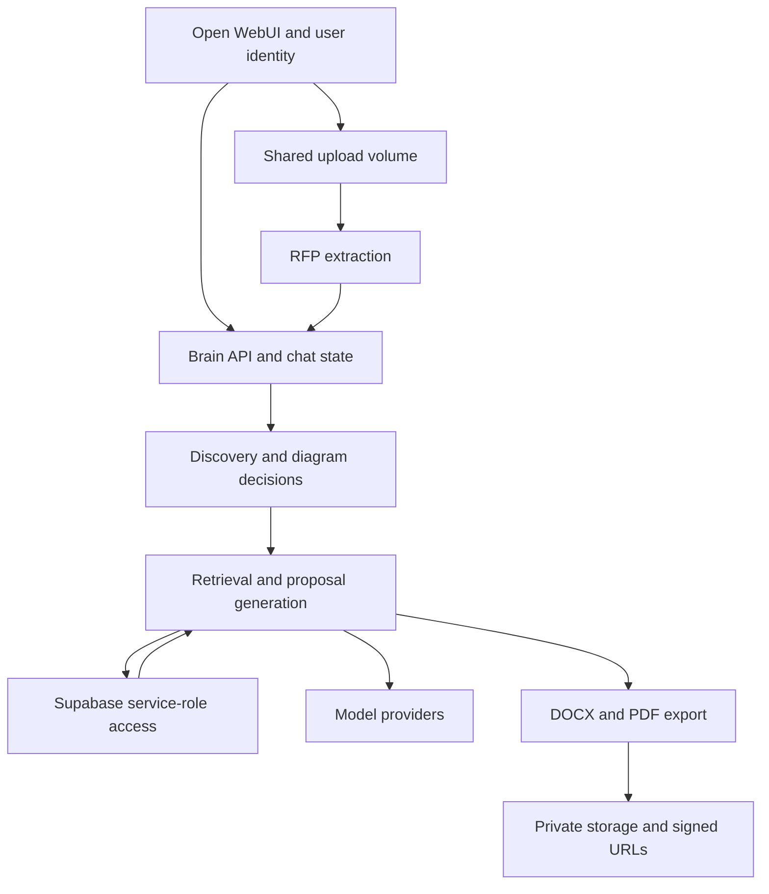

# Shilpi / iv-sarvam — Deep Engineering Audit

**Repository:** https://github.com/imranshaikh-commits/iv-sarvam/  
**Audited revision:** `3a5083025d555501a49365e32153962ba537a5d4` — Sprint 3.6: runbook and one-page user guide  
**Audit date:** 12 October 2026  
**Baseline:** Shilpi-Code-Audit.md, 12 findings, same repository revision  
**Deliverable:** independent source audit, local verification evidence and prioritized remediation plan  
**Repository changes:** none

## Executive assessment

**Keep building this product, but fix its trust and workflow foundations before treating generated proposals as ready for client release.** The application has real domain value: a structured discovery process, IAM-specific proposal templates, multi-vendor thinking, retrieval, diagram review and careful document assembly. It does not need an immediate wholesale rewrite.

The deeper problem is that the implementation can make its output look more certain and complete than its underlying evidence or state. A missing requirement can become “confirmed,” a negative review can advance a gate, an old diagram can be approved with a new one, and a failed save or export can be hidden by a successful-looking response. These are business correctness problems as much as software bugs.

This audit identifies **72 actionable findings**: **50 newly identified findings** and **22 retained or expanded entries mapping back to the original 12 baseline themes**. The new findings lead the detailed report. The full register is grouped by distinct fix boundary rather than inflating every symptom into a separate issue: **1 conditional P0, 34 P1, 34 P2 and 3 P3**. It adds **52 deterministic defect observations**, a clean-database migration/privilege lab, production-code coverage analysis and a bounded full-history credential-pattern scan. A passing observation test means the undesirable current behavior was reproduced; it is not a passing acceptance test for a repaired system.

The most urgent new security finding is a legacy privileged retrieval function that survives later migrations. In the local database lab, an anonymous role retrieved synthetic private content through that function while a direct table read was denied. **This establishes a defect in the checked-in schema chain under the documented lab conditions. It does not establish a live public data breach.** Production catalog and API exposure must be verified by the owner.

### What is good, bad, ugly and structurally wrong

| Assessment | What the evidence shows | Decision |
|---|---|---|
| Good | Useful domain model, structured templates, substantial regression tests, deterministic diagram specifications, separate proposal/product evidence, document-export investment | Preserve these assets and add stronger boundaries around them |
| Bad | Incorrect compliance claims, lost requirements, inconsistent scope interpretation, incomplete saves and exports | Treat as release correctness defects, not prompt-polishing tasks |
| Ugly | Very large orchestration modules, heuristic fallbacks that restore unwanted content, silent partial failures, stale operational assertions | Simplify control flow and make incomplete/error states first-class |
| Wrongly built | Authorization and approval live mainly in chat/UI conventions; evidence, decisions and artifacts lack a single immutable revision chain | Move these invariants into authenticated server-side domain services and persistence |
| Not yet proven | Live DB privileges, exact deployed image/schema, provider behavior, rendered layout, capacity, full restore, current dependency vulnerability status | Validate explicitly; do not infer production readiness from unit tests |

### Immediate decisions

1. **Verify and contain the legacy RPC exposure first** (F01). Also check signup/membership behavior (F02). Do not test by requesting real client content anonymously.
2. **Require human review of every client-bound proposal** until compliance truthfulness, extraction completeness and approval binding are fixed (F08–F14, F17–F20, F42).
3. **Stop global recent-file selection** before multiple colleagues use RFP ingestion concurrently (F04).
4. **Repair the deploy gate and establish a recoverable backup** before relying on frequent automated changes (F45–F46).
5. **Then improve retrieval and architecture**, rather than spending the next iteration mostly on prose length, branding or model substitution.

## 1. Scope, methods and limits

The audit followed the actual code paths from Open WebUI-compatible requests through intake, RFP extraction, state markers, diagram generation/review, retrieval, compliance, document generation, exports and persistence. It also inspected ingestion scripts, migrations, deployment, CI, backups and operational documentation. It used a local checkout at the pinned commit and a full 247-commit history. It did not change application source, apply fixes, deploy anything, contact colleagues, or inspect the prohibited `scripts/sarvam.env` file.

### Verification ledger

| Work | Result | What it proves / does not prove |
|---|---|---|
| Baseline reconciliation | All 12 baseline themes remain applicable; expanded below | Same code revision, not a claim of regressions introduced after the baseline |
| Existing suite, baseline run | 726 passed, 2 skipped, 183.03 seconds in the prior audit | Baseline test output retained; environment differed from this deeper run |
| Existing suite, deeper guarded run | 726 passed, 2 skipped, 4 warnings, 29.16 seconds | Outbound HTTP blocked; explicit in-process mock transports allowed; not live integration coverage |
| Unexpected network attempts | 29 attempts in 18 tests; 17 to example.invalid and 12 to OpenRouter hostname | Blocked by the audit harness with dummy keys; contradicts inherent “no network” claims |
| Additional defect observations | 52 passed, 3 warnings, 1.71 seconds | Deterministic current-defect reproductions with synthetic inputs and mocked providers |
| Runtime statement coverage | 5,023 / 7,698 statements, about 65.3%, excluding test files | Statement, not branch or requirement coverage; combined backend and scripts |
| Database lab | Migration 015 fails; old definer RPC survives; anonymous synthetic retrieval; automatic membership observed | Local PostgreSQL/pgvector behavior with Supabase-like role/schema scaffolding; not a live Supabase/PostgREST exploit test |
| Historical pattern scan | 247 commits, 621 eligible text blobs; one AWS key ID repeated in two doc blobs | Bounded pattern scan, not proof the repository/history is free of all secrets or client data |
| Positive safeguard checks | 10 passed, 0.17 seconds | Specific existing guards work; no claim that the whole workflow is safe |
| Repository integrity | Source checkout unchanged | All audit code/results are outside the repository |

The first unguarded coverage rerun did not complete in its time budget; it stalled on paths that attempted external requests. The subsequent guarded run completed. An initial version of the guard also blocked one legitimate `httpx.MockTransport` test; that was a harness error, corrected before the reported passing run. Neither event is counted as an application test failure. The evidence bundle preserves the final guarded results.

No real credentials were used for the synthetic checks, no paid-model generation was performed, and no live production API or customer data was probed. Provider-based quality and render fidelity remain unverified here. The environment did not provide a full production-equivalent D2/Graphviz/LibreOffice stack for end-to-end rendering, so this report does not certify DOCX/PDF visual quality. Docker deployment, failure recovery and production capacity were not executed.

The database lab used **PGlite 0.5.8 / PostgreSQL 18.3, pgvector 0.8.1 and pgcrypto 1.4**, with local auth/storage scaffolding. Production docs say PostgreSQL 17. After recording migration 015's failure, the lab used a clearly disclosed, in-memory `vector(1536)` substitution only to inspect migrations 016–019. This is not an approved production schema choice. Run the correction on the actual deployed version before closing F43.

### Severity and confidence

- **P0\***: verify/contain immediately because a potentially critical exposure is locally reproduced but its live reachability is unverified.
- **P1**: a material correctness, confidentiality, authorization, deployment or recovery issue that should be addressed before broad use or unreviewed client release.
- **P2**: a significant reliability, quality, integration or maintainability defect; schedule after urgent containment, with dependencies respected.
- **P3**: engineering hygiene or operational clarity; valuable but not equivalent to the release blockers.

“Local reproduction” uses real project functions with controlled inputs, often mocking network or provider dependencies. “Database lab” executes SQL locally. “Source” identifies a concrete code path and consequence, but its runtime scenario was not fully exercised. Architectural risks such as prompt injection and production load are labeled accordingly. Severity is a prioritization judgment, not an estimate of exploit probability or a legal conclusion.

## 2. Architecture and trust boundaries

The most consequential boundary is the brain's service-role access: it can read/write beyond what an individual user should be allowed to do. Therefore the API must establish identity and object authorization before each action. The current outer network/UI boundary is useful but insufficient for that invariant.

A second boundary is between evidence and commitments. Historical proposal text, product documentation, user answers and model output have different authority. The current pipeline too often flattens them into prompt text and later into confident prose. A third boundary is between a conversation state and an approved, recoverable business record. These should not be interchangeable.

### Existing strengths worth preserving

| Strength | Evidence / practical value | Improvement needed around it |
|---|---|---|
| IAM-specific templates and discovery | `intake_template.py`, `proposal_templates.py`, `scope_filter.py` distinguish work types and ask structured questions | Make required facts and scope decisions typed and durable |
| Separate product and past-proposal evidence | Partner corpus schema and retrieval keep product capabilities conceptually separate from prior delivery | Preserve source versions and require balanced, relevant evidence |
| Structured diagrams | `diagram_engine.py` uses diagram schemas and deterministic rendering paths rather than relying solely on prose | Bind review to exact spec/render revision and test rendered outputs |
| Broad regression investment | 726 passing tests, good helper coverage; many tests address caller wiring and prior regressions | Add cross-boundary invariants, failure injection and database tests |
| Document engineering | Real DOCX tables, headings, TOC work, branding, image fitting and PDF export | Preserve semantic correctness/completeness before final presentation |
| Useful deployment safeguards | Loopback brain/UI bindings, Caddy HTTPS, private storage, log rotation, image rollback mechanism | Authenticate internal requests, preserve test exit codes and prove recovery |
| Corpus curation and deduplication | Reviewed manifests, proposal hash uniqueness, product review flags | Bind review to actual bytes and make ingestion publication atomic |
| Candid operational notes | Docs acknowledge prior integration errors and “built but never wired” risks | Keep one current truth and test the assertions that control releases |

### Focused checks of what already works

The deeper pass also ran **10 positive safeguard tests**. These passed independently of the 52 defect observations, using synthetic data and no providers. The narrower conclusion matters: these functions enforce the specific property below even though the larger workflow still has gaps.

| Verified behavior | Why it is useful | Boundary of the result |
|---|---|---|
| Unknown diagram shapes fall back to a supported role | Raw shape/attribute strings are not accepted as renderer instructions | Does not validate architectural truth or D2 identifier uniqueness |
| DOT labels escape quotes and backslashes | Prevents straightforward label-based DOT attribute injection | Does not certify other renderer grammars |
| Diagram node count is bounded and dangling edges are removed | Limits runaway graph size and invalid references | Silent removals still need completeness reporting |
| Direct draft-to-approved transition is rejected by the transition helper | A useful local state-machine invariant already exists | Other approval paths and endpoint invariants still need consolidation |
| Rejection requires a reason in the transition helper | Gives rejection an explicit feedback contract | Does not provide an immutable authenticated audit trail |
| Library selection rejects unapproved and client-architecture assets | Useful defense against accidental reuse of client-specific diagrams | Fixed kit placement and provenance still need review |
| Partner asset selection requires a matching proposed vendor | Reduces accidental cross-vendor imagery | Does not establish licensing/current product accuracy |
| Missing PDF converter returns an explicit module-level error | Export engine communicates partial failure cleanly to its caller | Chat currently hides that error; F39 |
| Invalid DOCX compression preserves original bytes and reports a warning | Optional compression does not destroy input | Downstream callers must surface the warning appropriately |
| Vendor parsing preserves commas inside capability parentheses | A real multi-vendor integration edge case is handled correctly | Query vendor detection uses different rules; F62 |

### Capability-by-capability assessment

| Capability | Current assessment | What is needed to trust it |
|---|---|---|
| Structured discovery questions | Useful and extensively tested | Durable confirmed writes, conflict handling and honest completeness |
| Ordinary chat routing | Functional under tested inputs | Server-owned state and robust malformed-request handling |
| RFP field extraction | Implemented, incomplete-input cases unsafe | Per-page coverage, source spans, conflict review and full requirement register |
| Tender eligibility | User-facing gate exists | Explicit negative/ambiguous handling and per-gate decisions |
| Required response structure | Extracted and promised | Persistence, section planning and structural acceptance check |
| Scope tailoring | Useful template logic | Replace ambiguous heuristics and fallback restoration with explicit decisions |
| Proposal retrieval | Real corpus/type/topic machinery | Consistent vendor taxonomy, rank-preserving fusion and exact pipeline evaluation |
| Product evidence | Separate reviewed source model | Snapshot versioning, balanced retrieval and current-source review |
| Compliance matrix | Mechanically produces a client table | Preserve uncertainty and prove requirement satisfaction before commitment |
| Diagram schemas | Valuable typed foundation | Validate semantic graph properties and preserve them through rendering |
| Diagram appearance | Significant dedicated engineering | Real production-render QA and no meaning-changing layout shortcuts |
| Diagram approval | Local transition helper has real checks | Exact artifact/revision binding, successful render and authenticated decisions |
| Client references | A useful attempt to ground credentials | Authoritative delivery/reference-permission register and revocation |
| DOCX composition | Substantial tables/heading/image work | Complete requirements, safe timelines and traceable artifacts |
| PDF/lite export | Explicit module-level errors and image safeguards | UI partial-success contract, worker isolation and visual verification |
| Asset reuse | Approval filtering and vendor checks work | Correct document lineage, occurrence records and complete pagination |
| Ingestion | Manifest curation and dedup support exist | Byte-bound review, complete embeddings, atomic publication and topic stage |
| Deployment | Version tagging and rollback framework exist | Preserve test failure, pin builds and verify capabilities |
| Backup | Useful table export utility | Full consistency set and demonstrated empty-environment recovery |
| Usage tracking | Useful partial model telemetry | Full job accounting, unknown-cost states and shared admission limits |

## 3. Finding register

The detailed entries below include code anchors, impact, recommended implementation direction and a testable definition of done. Links are pinned to the audited commit, not a moving branch.

| ID | Priority | Origin | Finding | Evidence |
|---|---|---|---|---|
| F01 | P0* | Newly identified | [Legacy SECURITY DEFINER retrieval survives hardening](#f01) | Database lab + source |
| F02 | P1 | Newly identified | [New Supabase auth users automatically join the organization](#f02) | Database lab + source |
| F06 | P1 | Newly identified | [Sensitive query and source metadata still enter logs](#f06) | Source |
| F07 | P2 | Newly identified | [Retrieved document text is inserted into privileged prompt instructions](#f07) | Source; exploit not model-tested |
| F10 | P1 | Newly identified | [Text cleanup removes meaningful uncertainty and can delete real values](#f10) | Local reproductions + source |
| F12 | P1 | Newly identified | [Mixed scanned and text PDFs can lose image-only pages](#f12) | Local reproduction + source |
| F13 | P1 | Newly identified | [The system promises to follow a mandated RFP structure but does not wire it into generation](#f13) | Local reproduction + source |
| F14 | P1 | Newly identified | [A negative RFP review response can advance the eligibility gate](#f14) | Local reproduction + source |
| F15 | P2 | Newly identified | [RFP merging chooses longer answers instead of resolving conflicts](#f15) | Local reproduction + source |
| F16 | P2 | Newly identified | [The upload picker accepts formats the extraction path cannot process](#f16) | Source |
| F24 | P1 | Newly identified | [Scope filtering can remove included work or restore excluded work](#f24) | Local reproductions + source |
| F25 | P2 | Newly identified | [Fan-out retrieval undoes the reranker’s relevance order](#f25) | Local reproduction + source |
| F26 | P2 | Newly identified | [Prefix-based deduplication can discard distinct evidence](#f26) | Local reproduction + source |
| F27 | P2 | Newly identified | [A global product-evidence cap can starve one vendor](#f27) | Local reproduction + source |
| F28 | P1 | Newly identified | [Section prompts can omit the facts needed to draft the section](#f28) | Local reproductions + source |
| F29 | P1 | Newly identified | [Internal claim provenance is discarded before persistence](#f29) | Local reproduction + source |
| F30 | P2 | Newly identified | [A character-count heuristic can suppress weak-grounding warnings](#f30) | Local reproduction + source |
| F31 | P1 | Newly identified | [Past-proposal metadata is promoted into stronger delivery/reference claims](#f31) | Source |
| F32 | P2 | Newly identified | [DOCX ingestion breaks the relationship between tables and their headings](#f32) | Local reproductions + source |
| F33 | P1 | Newly identified | [Embedding responses are not validated for index, count or shape](#f33) | Local reproductions + source |
| F34 | P1 | Newly identified | [Partial ingestion can become permanently marked as already ingested](#f34) | Source |
| F35 | P2 | Newly identified | [Manifest review hashes are trusted without checking current file bytes](#f35) | Local reproduction + source |
| F36 | P2 | Newly identified | [Product source identity tracks the URL rather than the downloaded content](#f36) | Source |
| F37 | P2 | Newly identified | [Ingestion command options and the launcher do not match actual behavior](#f37) | Local reproductions + source |
| F41 | P2 | Newly identified | [Loose request parsing turns invalid inputs into server errors or unintended work](#f41) | Local reproductions + source |
| F42 | P1 | Newly identified | [A second truncated model response becomes ordinary completed text](#f42) | Local reproduction + source |
| F43 | P1 | Newly identified | [The checked-in migration chain cannot provision a clean partner corpus](#f43) | Database lab + source |
| F44 | P2 | Newly identified | [Organization bootstrap and application defaults disagree](#f44) | Database lab + source |
| F51 | P3 | Newly identified | [Public repository hygiene still exposes a credential identifier](#f51) | History pattern scan + source |
| F52 | P2 | Newly identified | [Streaming fallback can append a second answer after partial output](#f52) | Source |
| F53 | P2 | Newly identified | [The Graphviz fallback loses diagram shape semantics](#f53) | Local reproduction + source |
| F54 | P1 | Newly identified | [The stack renderer ignores the graph and fabricates adjacency connections](#f54) | Local reproduction + source |
| F55 | P2 | Newly identified | [D2 identifier normalization can merge separate zones](#f55) | Local reproduction + source |
| F56 | P2 | Newly identified | [Render-time compaction merges distinct node roles and edge meanings](#f56) | Local reproduction + source |
| F57 | P1 | Newly identified | [Diagram deduplication can discard materially different approved designs](#f57) | Local reproduction + source |
| F58 | P2 | Newly identified | [Diagram connectivity checks can pass disconnected components](#f58) | Local reproduction + source |
| F59 | P1 | Newly identified | [Foreign keys do not enforce same-organization relationships or valid backreferences](#f59) | Database lab + source |
| F60 | P1 | Newly identified | [Storage provisioning and proposed access policies do not match runtime object paths](#f60) | Database lab + source |
| F61 | P1 | Newly identified | [Deployment-type inference can turn an explicit SaaS prohibition into SaaS sizing](#f61) | Local reproduction + source |
| F62 | P2 | Newly identified | [Vendor detection matches ordinary words and omits supported vendors](#f62) | Local reproduction + source |
| F63 | P2 | Newly identified | [The retrieval scorecard measures a different pipeline and crashes on zero hits](#f63) | Local reproduction + source |
| F64 | P2 | Newly identified | [Reference-book caching delays withdrawal of client claims](#f64) | Local reproduction + source |
| F65 | P2 | Newly identified | [Asset extraction joins source documents by basename, losing provenance](#f65) | Source |
| F66 | P3 | Newly identified | [Asset recurrence scoring cannot measure reuse from the stored data model](#f66) | Source |
| F67 | P2 | Newly identified | [Some corpus and asset readers silently stop at service page limits](#f67) | Source |
| F68 | P2 | Newly identified | [Newly ingested chunks bypass the topic-classification stage used by retrieval](#f68) | Source |
| F69 | P1 | Newly identified | [A diagram can be approved even when it has never rendered successfully](#f69) | Local API reproduction + source |
| F70 | P2 | Newly identified | [Deployment readiness checks do not verify critical product capabilities](#f70) | Source |
| F71 | P2 | Newly identified | [Generated timeline values can crash document assembly](#f71) | Local reproduction + source |
| F72 | P1 | Newly identified | [The deterministic stack inserts product and capability claims not present in discovery](#f72) | Local reproduction + source |
| F03 | P1 | Baseline retained or expanded | [The brain trusts network reachability instead of authenticating and authorizing requests](#f03) | Local API reproduction + source |
| F04 | P1 | Baseline retained or expanded | [RFP attachment selection can choose another user’s upload](#f04) | Local reproduction + source |
| F05 | P1 | Baseline retained or expanded | [Logo ingestion permits arbitrary server fetches and local paths](#f05) | Source |
| F08 | P1 | Baseline retained or expanded | [Compliance rendering converts uncertainty into an affirmative client claim](#f08) | Local reproductions + source |
| F09 | P1 | Baseline retained or expanded | [Grounding validation accepts contradictory and negated evidence](#f09) | Local reproductions + source |
| F11 | P1 | Baseline retained or expanded | [Multiple independent RFP caps can silently remove mandatory requirements](#f11) | Local reproductions + source |
| F17 | P1 | Baseline retained or expanded | [Approval is a chat convention, not a server-enforced generation invariant](#f17) | Local API reproduction + source |
| F18 | P1 | Baseline retained or expanded | [Approving one diagram approves every pending version for the proposal](#f18) | Local reproductions + source |
| F19 | P1 | Baseline retained or expanded | [Fail-soft persistence can be reported to the user as success](#f19) | Local reproductions + source |
| F20 | P1 | Baseline retained or expanded | [Concurrent intake edits can overwrite each other](#f20) | Source; deterministic interleaving |
| F21 | P2 | Baseline retained or expanded | [Empty plans and skipped diagrams have inconsistent meanings](#f21) | Local reproductions + source |
| F22 | P2 | Baseline retained or expanded | [Generated artifacts are not cleanly linked to their approved design snapshot](#f22) | Source |
| F23 | P2 | Baseline retained or expanded | [Recorded actor emails are best-effort labels, not an audit trail](#f23) | Source |
| F38 | P1 | Baseline retained or expanded | [Long-running generation has no durable job or idempotency boundary](#f38) | Source |
| F39 | P2 | Baseline retained or expanded | [Export success and warnings are not represented consistently](#f39) | Local reproductions + source |
| F40 | P2 | Baseline retained or expanded | [Artifact recovery relies on expiring links and temporary local paths](#f40) | Source |
| F45 | P1 | Baseline retained or expanded | [The deployment test pipeline can hide pytest failure](#f45) | Source + shell semantics reproduced in baseline |
| F46 | P1 | Baseline retained or expanded | [Table exports are not a complete or consistent disaster-recovery plan](#f46) | Source |
| F47 | P2 | Baseline retained or expanded | [Tests cover many helpers but do not establish production invariants](#f47) | Measured suite/coverage + source |
| F48 | P2 | Baseline retained or expanded | [Builds and integrations are not fully reproducible](#f48) | Source |
| F49 | P2 | Baseline retained or expanded | [Usage telemetry is incomplete and does not enforce spend limits](#f49) | Source |
| F50 | P3 | Baseline retained or expanded | [Large orchestration modules and stale operational assertions make changes fragile](#f50) | Source |

## 4A. Newly identified findings

### F01 — Legacy SECURITY DEFINER retrieval survives hardening

**Priority:** P0* · **Origin:** Newly identified · **Evidence:** Database lab + source

**Code:** [supabase/migrations/001_init.sql:218](https://github.com/imranshaikh-commits/iv-sarvam/blob/3a5083025d555501a49365e32153962ba537a5d4/supabase/migrations/001_init.sql#L218); [supabase/migrations/sarvam_018_function_hardening.sql:20](https://github.com/imranshaikh-commits/iv-sarvam/blob/3a5083025d555501a49365e32153962ba537a5d4/supabase/migrations/sarvam_018_function_hardening.sql#L20)

The original `match_proposal_chunks(vector,double precision,integer,uuid,text,text,text,text)` remains after the later text-signature functions are created. It executes with the owner's privileges and permits a null organization filter. Migration 018 hardens a different overload; it does not remove this one or revoke its default execute privilege.

The local migration lab found three surviving overloads. With role `anon`, a direct read of the synthetic corpus was denied, but calling the legacy function returned `SYNTHETIC_PRIVATE_CONTENT`. The lab granted ordinary schema/table access to simulate a Supabase role; it did not grant special execute rights to this function. PostgreSQL functions receive PUBLIC execute by default unless revoked.

This is a critical schema-level bypass, conditional on the function and privileges actually existing in production and being reachable through its database/API configuration. The live catalog, PostgREST route, and production data were not inspected. Do not report this as a confirmed public breach. Verify it before expanding usage.

**Fix:** Inventory every overload by complete signature. In a forward migration, remove unused overloads or revoke access from PUBLIC/anon/authenticated as appropriate. Use invoker security for the intended RPC and explicit organization authorization. Pin search_path for any justified definer function. Verify migrations and current database state independently.

**Acceptance:** On a clean database and an upgraded database, catalog assertions allow only intended signatures. Anonymous and cross-organization callers cannot retrieve a synthetic private chunk through any overload. A service-role/authorized caller still retrieves it. Verify deployed catalog read-only first.

### F02 — New Supabase auth users automatically join the organization

**Priority:** P1 · **Origin:** Newly identified · **Evidence:** Database lab + source

**Code:** [supabase/migrations/001_init.sql:70](https://github.com/imranshaikh-commits/iv-sarvam/blob/3a5083025d555501a49365e32153962ba537a5d4/supabase/migrations/001_init.sql#L70)

`handle_new_user` creates membership in the default organization whenever an auth user is inserted. The lab inserted an unrelated synthetic auth user and observed one organization membership without an invitation decision. Once Supabase Auth is used, this can convert account creation into access to the organization's corpus through membership policies.

Today the documented application identity comes from Open WebUI, and the migration comments say Supabase auth.users was empty. Whether public signup is enabled is unknown. That limits current exploitability but makes this a dangerous latent default, particularly during the planned auth migration.

**Fix:** Separate account creation from invitation acceptance. Allow membership only through an authorized invitation/admin workflow, enforce verified identity and intended organization, and remove the automatic broad enrollment trigger behavior.

**Acceptance:** An unrelated verified signup has zero memberships. An invited user joins only the invited organization. Replaying an invitation does not duplicate or broaden membership.

### F06 — Sensitive query and source metadata still enter logs

**Priority:** P1 · **Origin:** Newly identified · **Evidence:** Source

**Code:** [backend/brain/app.py:4023](https://github.com/imranshaikh-commits/iv-sarvam/blob/3a5083025d555501a49365e32153962ba537a5d4/backend/brain/app.py#L4023); [backend/brain/supabase_client.py:54](https://github.com/imranshaikh-commits/iv-sarvam/blob/3a5083025d555501a49365e32153962ba537a5d4/backend/brain/supabase_client.py#L54); [deploy/docker-compose.yml:28](https://github.com/imranshaikh-commits/iv-sarvam/blob/3a5083025d555501a49365e32153962ba537a5d4/deploy/docker-compose.yml#L28)

The vault path logs the first 80 characters of the actual query plus retrieved client names and headings. This runs independently of the opt-in payload-shape logging flag. Database error formatting also includes backend error details, which can contain row values. The compose comments say client-text logging was removed, but this path remains.

Rotation limits disk use; it does not make content safe to log. Customer names, tender details, and requirements may reach host logs or downstream collectors. No production logs were read, and no historical disclosure volume is asserted.

**Fix:** Log request IDs, duration, counts, and redacted error classifications. Remove query/row content from default logs and sanitize provider/database exceptions centrally. Review existing retention/access and redact or expire past sensitive logs under the owner's policy.

**Acceptance:** Run synthetic PII and unique canary phrases through success and error paths; captured logs contain no canary, customer name, document text, or credential. Debug mode remains explicit and access controlled.

### F07 — Retrieved document text is inserted into privileged prompt instructions

**Priority:** P2 · **Origin:** Newly identified · **Evidence:** Source; exploit not model-tested

**Code:** [backend/brain/app.py:727](https://github.com/imranshaikh-commits/iv-sarvam/blob/3a5083025d555501a49365e32153962ba537a5d4/backend/brain/app.py#L727); [backend/brain/document_engine.py:1368](https://github.com/imranshaikh-commits/iv-sarvam/blob/3a5083025d555501a49365e32153962ba537a5d4/backend/brain/document_engine.py#L1368)

`build_grounded_system` concatenates corpus text into the system prompt. Document prose and model instructions consequently share the same privileged message. A malicious or simply instruction-heavy source document can try to override drafting behavior or introduce unsupported claims. Delimiters and a curated corpus help, but they do not enforce the distinction between evidence and instructions.

This is an architectural prompt-injection risk, not a demonstrated model exploit in this audit: no paid model calls or hostile live corpus uploads were made. The strongest consequence here is corrupted proposal content; there is no basis to claim arbitrary tool execution from this prompt alone.

**Fix:** Keep immutable instructions separate from clearly typed evidence payloads. Treat source text as data, carry source IDs, constrain generated structures, and validate business claims outside the model. Restrict who can publish reviewed corpus versions.

**Acceptance:** A synthetic corpus containing instructions to ignore policy, claim false certification, or invent compliance does not change workflow authorization or produce unchecked client claims. Preserve the evidence and evaluation results.

### F10 — Text cleanup removes meaningful uncertainty and can delete real values

**Priority:** P1 · **Origin:** Newly identified · **Evidence:** Local reproductions + source

**Code:** [backend/brain/document_qa.py:54](https://github.com/imranshaikh-commits/iv-sarvam/blob/3a5083025d555501a49365e32153962ba537a5d4/backend/brain/document_qa.py#L54); [backend/brain/document_qa.py:132](https://github.com/imranshaikh-commits/iv-sarvam/blob/3a5083025d555501a49365e32153962ba537a5d4/backend/brain/document_qa.py#L132); [backend/brain/document_engine.py:1195](https://github.com/imranshaikh-commits/iv-sarvam/blob/3a5083025d555501a49365e32153962ba537a5d4/backend/brain/document_engine.py#L1195)

The QA pass removed “(needs SME confirmation)” from a 99.99% availability guarantee while leaving the guarantee intact. Although `qa_text` emits an issue, the normal draft retry path does not turn this into a persistent release gate. A second reproduction showed the citation stripper deleting real bracketed values such as a retention period and supported version list.

Client documents should not contain internal drafting annotations, but removing the annotation is not equivalent to resolving the underlying claim. Broad regex cleanup creates polished but potentially less accurate output. Citation syntax also overlaps legitimate technical prose.

**Fix:** Represent uncertainty and evidence as structured fields, not prose markers. Resolve or remove the unverified claim before rendering client text. Strip only a reserved citation format or actual citation nodes, not arbitrary brackets containing numbers. Persist all material QA issues.

**Acceptance:** Cleaning never converts an unverified guarantee into an unconditional promise. Real bracketed quantities and version strings survive. A claim requiring review prevents release until resolved.

### F12 — Mixed scanned and text PDFs can lose image-only pages

**Priority:** P1 · **Origin:** Newly identified · **Evidence:** Local reproduction + source

**Code:** [backend/brain/rfp_intake.py:173](https://github.com/imranshaikh-commits/iv-sarvam/blob/3a5083025d555501a49365e32153962ba537a5d4/backend/brain/rfp_intake.py#L173); [backend/brain/rfp_intake.py:526](https://github.com/imranshaikh-commits/iv-sarvam/blob/3a5083025d555501a49365e32153962ba537a5d4/backend/brain/rfp_intake.py#L526)

`needs_vision` makes a document-level decision from aggregate/average text availability. A readable text page followed by an empty scanned page was classified as not needing vision. Requirements appearing only on that scanned page can therefore disappear even in a short document below the page cap.

The code addresses fully scanned tenders, which is valuable, but mixed PDFs are common: a cover letter or digital form can coexist with image-only annexures. Document-level averages cannot establish page-level extraction coverage.

**Fix:** Assess every page independently. Use text extraction where adequate and OCR/vision for sparse or image-only pages. Record page counts, extraction mode, failed pages and confidence; preserve page references in each extracted requirement.

**Acceptance:** A mixed PDF with a unique mandatory clause only on a scanned page recovers that clause and cites the correct page. Blank separator pages are distinguishable from failed extraction. Extraction failures remain visible.

### F13 — The system promises to follow a mandated RFP structure but does not wire it into generation

**Priority:** P1 · **Origin:** Newly identified · **Evidence:** Local reproduction + source

**Code:** [backend/brain/rfp_intake.py:328](https://github.com/imranshaikh-commits/iv-sarvam/blob/3a5083025d555501a49365e32153962ba537a5d4/backend/brain/rfp_intake.py#L328); [backend/brain/app.py:3340](https://github.com/imranshaikh-commits/iv-sarvam/blob/3a5083025d555501a49365e32153962ba537a5d4/backend/brain/app.py#L3340); [backend/brain/document_engine.py:1368](https://github.com/imranshaikh-commits/iv-sarvam/blob/3a5083025d555501a49365e32153962ba537a5d4/backend/brain/document_engine.py#L1368)

Extraction captures `mandated_structure`, and the review text tells the user “I will follow it.” However, `RfpExtraction.answers()` does not persist that structure, and the chat/generation orchestration does not pass it into the proposal builder. The synthetic check verifies this disconnect.

A response can thus use the system's preferred template while assuring the user it will follow the tender's required outline. This matters for tenders with prescribed sections, response schedules or evaluator numbering. The root cause is an unwired capability, not a weak prompt.

**Fix:** Persist the exact ordered required structure with source references. Map requirements and generated sections to it, explicitly handle unsupported required forms, and run a structural completeness validator before release. Change the review wording until the promise is actually implemented.

**Acceptance:** A tender requiring an unusual order and exact mandatory appendix produces that order and appendix, or blocks with a clear unsupported-structure explanation. The structure survives a restart and session reload.

### F14 — A negative RFP review response can advance the eligibility gate

**Priority:** P1 · **Origin:** Newly identified · **Evidence:** Local reproduction + source

**Code:** [backend/brain/app.py:3450](https://github.com/imranshaikh-commits/iv-sarvam/blob/3a5083025d555501a49365e32153962ba537a5d4/backend/brain/app.py#L3450); [backend/brain/rfp_intake.py:368](https://github.com/imranshaikh-commits/iv-sarvam/blob/3a5083025d555501a49365e32153962ba537a5d4/backend/brain/rfp_intake.py#L368)

The review branch recognizes broad text patterns such as “continue.” A local API reproduction submitted “Do not continue; mandatory qualification is not met.” The state advanced to the diagram-plan stage. The negative user decision was overridden by keyword matching.

Eligibility gates are shown in text but do not become a durable per-gate decision model. Advancing the conversation therefore does not prove that disqualifying tender conditions were checked. This is distinct from diagram approval and needs its own business rule.

**Fix:** Use explicit review actions with server-side state and structured per-gate decisions. A negative or ambiguous response must preserve the gate. Record unmet conditions and the authority/rationale for any permissible override; do not infer qualification from conversational continuation.

**Acceptance:** Negated continue/all-met phrases, mixed responses, and explicit unmet qualifications never advance automatically. Each mandatory gate has a persisted, attributable decision before drafting.

### F15 — RFP merging chooses longer answers instead of resolving conflicts

**Priority:** P2 · **Origin:** Newly identified · **Evidence:** Local reproduction + source

**Code:** [backend/brain/rfp_intake.py:526](https://github.com/imranshaikh-commits/iv-sarvam/blob/3a5083025d555501a49365e32153962ba537a5d4/backend/brain/rfp_intake.py#L526)

Page extraction merges competing field values by preferring the longer value. In the synthetic test, an earlier lengthy country value overrode a later shorter conflicting value. Repeated requirement references were retained as separate requirements. This can preserve introductory boilerplate over a later controlling clause and inflate the requirement count.

The extraction also truncates individual values and requirement/gate text. Without source provenance and conflict status, the user sees one selected answer rather than the disagreement that needs review. Longer is not a reliable proxy for authoritative or correct.

**Fix:** Keep candidate values with page/span provenance. Resolve only unambiguous duplicates automatically; flag conflicting values and document amendments for review. Deduplicate requirements by normalized reference plus meaning while preserving all source occurrences.

**Acceptance:** Repeated identical requirements merge, distinct requirements sharing a heading remain separate, and contradictory country/capacity/date values create a review item rather than a silent longest-value winner.

### F16 — The upload picker accepts formats the extraction path cannot process

**Priority:** P2 · **Origin:** Newly identified · **Evidence:** Source

**Code:** [backend/brain/rfp_intake.py:55](https://github.com/imranshaikh-commits/iv-sarvam/blob/3a5083025d555501a49365e32153962ba537a5d4/backend/brain/rfp_intake.py#L55); [backend/brain/rfp_intake.py:395](https://github.com/imranshaikh-commits/iv-sarvam/blob/3a5083025d555501a49365e32153962ba537a5d4/backend/brain/rfp_intake.py#L395); [backend/brain/rfp_intake.py:418](https://github.com/imranshaikh-commits/iv-sarvam/blob/3a5083025d555501a49365e32153962ba537a5d4/backend/brain/rfp_intake.py#L418)

The candidate suffix list includes DOCX, DOC, TXT, MD and RTF, but the extraction path uses PDF-specific `pdftotext` and `pdftoppm`. There is no equivalent format-dispatch conversion path between selection and extraction. An accepted attachment can fail later with a processing error instead of a useful unsupported-format message.

This also compounds recency selection: a newly uploaded non-PDF can become the chosen “RFP” and displace the intended PDF. The issue is based on call-path inspection; every native parser format was not executed here.

**Fix:** Dispatch by verified media type to supported parsers, or accept only PDFs until other formats are implemented. Validate content signatures, not just suffixes, and show supported formats before work starts.

**Acceptance:** Each advertised format succeeds on a minimal valid fixture. Unsupported or mislabeled files return a clear validation error without entering extraction or selecting a different user's file.

### F24 — Scope filtering can remove included work or restore excluded work

**Priority:** P1 · **Origin:** Newly identified · **Evidence:** Local reproductions + source

**Code:** [backend/brain/scope_filter.py:107](https://github.com/imranshaikh-commits/iv-sarvam/blob/3a5083025d555501a49365e32153962ba537a5d4/backend/brain/scope_filter.py#L107); [backend/brain/scope_filter.py:158](https://github.com/imranshaikh-commits/iv-sarvam/blob/3a5083025d555501a49365e32153962ba537a5d4/backend/brain/scope_filter.py#L158); [backend/brain/scope_filter.py:248](https://github.com/imranshaikh-commits/iv-sarvam/blob/3a5083025d555501a49365e32153962ba537a5d4/backend/brain/scope_filter.py#L248)

Keyword matching interprets “No exclusions for training; training remains in scope” as an exclusion. A separate minimum-section fallback restores a small selected template after filtering, reintroducing an explicitly excluded training section. If subsection filtering removes all entries, the original list is also restored.

These are three manifestations of the same problem: broad heuristics and fallback defaults override explicit scope semantics. The consequence can be a proposal that omits contracted work or promises work the team explicitly excluded. Prompt instructions cannot repair a deterministic section list that is already wrong.

**Fix:** Represent scope as explicit included/excluded/unknown decisions with provenance. Never let a fallback override an explicit exclusion. If too little valid scope remains, stop and request clarification instead of restoring a template silently.

**Acceptance:** Negated exclusions, explicit exclusions, tiny engagements, empty subsection sets and mixed-vendor scope produce the expected section set. Every required item maps to included work or a visible exception.

### F25 — Fan-out retrieval undoes the reranker’s relevance order

**Priority:** P2 · **Origin:** Newly identified · **Evidence:** Local reproduction + source

**Code:** [backend/brain/app.py:311](https://github.com/imranshaikh-commits/iv-sarvam/blob/3a5083025d555501a49365e32153962ba537a5d4/backend/brain/app.py#L311); [backend/brain/document_engine.py:1020](https://github.com/imranshaikh-commits/iv-sarvam/blob/3a5083025d555501a49365e32153962ba537a5d4/backend/brain/document_engine.py#L1020)

The retrieval helper can return an LLM-reranked list, but `_retrieve_fanout` merges and sorts the results again by raw similarity. In the synthetic check, a passage ranked first for relevance with a lower cosine score lost to a passage ranked second with a higher cosine score.

This spends effort on reranking and then discards its primary result. Across multiple queries, raw scores can also have different distributions; sorting all of them together is not a principled fusion strategy. The defect reduces relevance even if each individual retrieval function behaves as intended.

**Fix:** Carry explicit rerank scores/ranks and query provenance. Fuse candidate rankings deliberately, then apply final diversity and relevance selection once. Evaluate against labeled task-specific relevance judgments rather than just similarity thresholds.

**Acceptance:** A known more relevant reranked passage remains ahead through fan-out and final selection. A fixed golden query set shows no regression in required-topic recall or citation quality.

### F26 — Prefix-based deduplication can discard distinct evidence

**Priority:** P2 · **Origin:** Newly identified · **Evidence:** Local reproduction + source

**Code:** [backend/brain/document_engine.py:1020](https://github.com/imranshaikh-commits/iv-sarvam/blob/3a5083025d555501a49365e32153962ba537a5d4/backend/brain/document_engine.py#L1020); [backend/brain/app.py:311](https://github.com/imranshaikh-commits/iv-sarvam/blob/3a5083025d555501a49365e32153962ba537a5d4/backend/brain/app.py#L311)

Fan-out deduplication keys passages by an initial text prefix (160 characters). The synthetic test used the same introductory text followed by two different requirements; only one survived. Upstream retrieval also uses heuristic near-duplicate/prefix handling.

Common boilerplate is especially likely in proposals and product documentation. Two chunks with identical introductions may contain different capacity limits, exclusions or commercial commitments later. Discarding them as duplicates can erase the very detail the drafter needs.

**Fix:** Use stable chunk IDs for exact duplicate retrievals and full normalized-content hashes for truly duplicate content. If semantic near-duplicate suppression is retained, preserve materially different numbers, conditions and provenance.

**Acceptance:** Identical chunk IDs merge while same-prefix/different-tail chunks survive. Tests cover conflicting capacities, requirements and exclusions after long shared boilerplate.

### F27 — A global product-evidence cap can starve one vendor

**Priority:** P2 · **Origin:** Newly identified · **Evidence:** Local reproduction + source

**Code:** [backend/brain/document_engine.py:1020](https://github.com/imranshaikh-commits/iv-sarvam/blob/3a5083025d555501a49365e32153962ba537a5d4/backend/brain/document_engine.py#L1020)

Product candidates from all vendors are pooled, sorted and then capped at six times the number of vendors. This is not a per-vendor quota. In a supported higher-top_k test with two vendors, all 12 retained passages came from vendor A and none from vendor B.

The exact failure depends on the candidate count and scores; it is not claimed to occur on every default query. Nevertheless, the function's stated diversity intent does not hold over its accepted parameter range. A multi-vendor solution can consequently be drafted from asymmetric product evidence.

**Fix:** Reserve a justified minimum/maximum allocation per in-scope vendor or capability before global ranking. Make missing vendor evidence explicit and prevent one vendor's material from being used as proof for another.

**Acceptance:** Across default and supported high top_k values, each vendor with relevant eligible evidence remains represented. A genuinely unsupported vendor produces a visible evidence gap, not substituted claims.

### F28 — Section prompts can omit the facts needed to draft the section

**Priority:** P1 · **Origin:** Newly identified · **Evidence:** Local reproductions + source

**Code:** [backend/brain/document_engine.py:670](https://github.com/imranshaikh-commits/iv-sarvam/blob/3a5083025d555501a49365e32153962ba537a5d4/backend/brain/document_engine.py#L670); [backend/brain/document_engine.py:1368](https://github.com/imranshaikh-commits/iv-sarvam/blob/3a5083025d555501a49365e32153962ba537a5d4/backend/brain/document_engine.py#L1368)

Each section receives a prefix of the RFP rather than a requirement-to-section allocation. A test placed a critical instruction after 4,000 characters and confirmed it never reached the section prompt. Discovery context is also bounded and ordered with general fields before technical ones; sufficiently long early fields can crowd out the relevant facts.

This is related to the global completeness caps but has a separate remedy: even a fully extracted requirement register is ineffective if generation does not select the relevant entries for each section. Increasing the context window alone would remain fragile and expensive.

**Fix:** Plan sections from the requirement register and allocate their exact applicable facts/evidence. Budget context by importance and section relevance, preserving mandatory constraints. Record which requirement IDs were supplied to each draft.

**Acceptance:** A mandatory late-page requirement reaches every relevant section regardless of its position in the original document. Long customer names or narrative introductions do not displace critical sizing/security facts.

### F29 — Internal claim provenance is discarded before persistence

**Priority:** P1 · **Origin:** Newly identified · **Evidence:** Local reproduction + source

**Code:** [backend/brain/document_engine.py:1140](https://github.com/imranshaikh-commits/iv-sarvam/blob/3a5083025d555501a49365e32153962ba537a5d4/backend/brain/document_engine.py#L1140); [backend/brain/document_engine.py:3148](https://github.com/imranshaikh-commits/iv-sarvam/blob/3a5083025d555501a49365e32153962ba537a5d4/backend/brain/document_engine.py#L3148); [backend/brain/app.py:2869](https://github.com/imranshaikh-commits/iv-sarvam/blob/3a5083025d555501a49365e32153962ba537a5d4/backend/brain/app.py#L2869)

Generated sections may carry citation objects, but the returned/persisted `sections_meta` keeps summary counts and review metrics rather than actual evidence chunk/product IDs. A test injected identifiable citation IDs and showed they absent from the metadata. Client-facing citation removal is a deliberate product choice; internal provenance removal is not necessary to satisfy it.

Without retained source versions, prompt/model identity, input revision and claim mappings, reviewers cannot reliably investigate why a promise was made or whether a later corpus update invalidates it. Citation counts are not a substitute for traceable evidence.

**Fix:** Store an internal generation manifest: input hashes/revisions, requirement IDs, retrieved chunk/source versions, model and prompt/config versions, claim-to-evidence links, QA findings, decisions and output hashes. Keep it separate from the clean client document.

**Acceptance:** A reviewer can trace a sampled SLA, capacity, product claim and compliance row from exported file back to exact evidence and approval. Re-running after a source update produces a distinct manifest.

### F30 — A character-count heuristic can suppress weak-grounding warnings

**Priority:** P2 · **Origin:** Newly identified · **Evidence:** Local reproduction + source

**Code:** [backend/brain/document_engine.py:670](https://github.com/imranshaikh-commits/iv-sarvam/blob/3a5083025d555501a49365e32153962ba537a5d4/backend/brain/document_engine.py#L670); [backend/brain/document_engine.py:1368](https://github.com/imranshaikh-commits/iv-sarvam/blob/3a5083025d555501a49365e32153962ba537a5d4/backend/brain/document_engine.py#L1368)

The weak-corpus guard treats discovery context above a character threshold as sufficient client facts. A synthetic set containing only verbose customer/vendor/industry/country labels exceeded that threshold without any topology, deployment or sizing inputs.

Having more characters does not establish the facts necessary for a technical section. The effect is particularly risky when an otherwise sparse evidence set produces fluent text that no longer carries an appropriate review warning. This does not prove the model will hallucinate on every such request; it proves the gate can be satisfied without the required kind of information.

**Fix:** Define typed minimum facts by section and engagement type. Separate completeness from prose length. Require evidence or explicit assumptions for each technical claim category, and preserve unresolved gaps in release status.

**Acceptance:** Long identity fields cannot satisfy architecture/sizing prerequisites. Adequate structured technical facts can satisfy them even when concise. Missing inputs produce targeted questions or explicit unresolved assumptions.

### F31 — Past-proposal metadata is promoted into stronger delivery/reference claims

**Priority:** P1 · **Origin:** Newly identified · **Evidence:** Source

**Code:** [backend/brain/document_engine.py:276](https://github.com/imranshaikh-commits/iv-sarvam/blob/3a5083025d555501a49365e32153962ba537a5d4/backend/brain/document_engine.py#L276)

The reference-book builder presents proposals marked `outcome='won'` as delivered engagements. Winning a proposal is not the same as completing delivery. It also uses mentions in another proposal as support for reference-book inclusion; a mention alone does not establish customer permission to be named or current relationship facts.

This is a semantic error in the evidence model, not an assertion that any particular client reference is false. Reusing historical proposal marketing text can compound the problem by making repeated claims look independently verified.

**Fix:** Maintain an authoritative approved-reference register with actual delivery status, approved wording, permitted audiences, date and owner. Keep commercial outcome separate from delivery completion and reference permission. Generate credentials only from that register.

**Acceptance:** A won-but-not-delivered engagement is never described as delivered. An unapproved client name does not appear in client credentials. Expired approvals and changed partner/certification claims require review.

### F32 — DOCX ingestion breaks the relationship between tables and their headings

**Priority:** P2 · **Origin:** Newly identified · **Evidence:** Local reproductions + source

**Code:** [scripts/ingest_v2.py:118](https://github.com/imranshaikh-commits/iv-sarvam/blob/3a5083025d555501a49365e32153962ba537a5d4/scripts/ingest_v2.py#L118); [scripts/ingest_v2.py:463](https://github.com/imranshaikh-commits/iv-sarvam/blob/3a5083025d555501a49365e32153962ba537a5d4/scripts/ingest_v2.py#L463)

The DOCX extractor walks paragraphs and then tables separately rather than preserving document body order. Tables receive generic headings such as “Table 1.” A generated fixture with a production-sizing heading produced a table chunk without that heading. Long table chunking also joins whitespace and flattens row boundaries.

For IAM proposals, tables frequently carry the actual server sizing, license metrics, RACI roles and assumptions. Losing title/row context makes retrieval less precise and can associate values with the wrong environment. Good language-model drafting cannot reliably reconstruct relationships already destroyed during ingestion.

**Fix:** Walk OOXML body elements in order. Attach section/heading ancestry to tables and preserve cell/row structure; split long tables with repeated headers and source coordinates. Store semantic type alongside raw extraction.

**Acceptance:** An interleaved heading/paragraph/table fixture preserves original order, section ownership and headers across chunks. Retrieval for production sizing returns the production table, not a similarly shaped test-environment table.

### F33 — Embedding responses are not validated for index, count or shape

**Priority:** P1 · **Origin:** Newly identified · **Evidence:** Local reproductions + source

**Code:** [scripts/ingest_v2.py:493](https://github.com/imranshaikh-commits/iv-sarvam/blob/3a5083025d555501a49365e32153962ba537a5d4/scripts/ingest_v2.py#L493); [scripts/ingest_v2.py:865](https://github.com/imranshaikh-commits/iv-sarvam/blob/3a5083025d555501a49365e32153962ba537a5d4/scripts/ingest_v2.py#L865); [scripts/ingest_partner_products.py:252](https://github.com/imranshaikh-commits/iv-sarvam/blob/3a5083025d555501a49365e32153962ba537a5d4/scripts/ingest_partner_products.py#L252)

Embedding values are consumed in response-array order rather than assigned by the returned `index`. A reversed synthetic response swapped embeddings between two texts. A short response was accepted, and `zip(all_chunks, embeddings)` silently dropped the unmatched chunk. The pipeline can then report successful insertion of fewer chunks without identifying the missing source content.

Providers may normally return ordered complete arrays, but data integrity should not depend on that assumption. Provider errors, adapter changes or partial responses must fail before corrupting retrieval.

**Fix:** Validate exactly one unique in-range index per input, expected dimension and finite numeric values. Reorder by index. Require expected chunk count to equal validated embedding and committed row counts; never use silent zip truncation as validation.

**Acceptance:** Reversed responses map correctly; short, duplicated-index, wrong-dimension and nonfinite responses fail the batch before any completed corpus version is published.

### F34 — Partial ingestion can become permanently marked as already ingested

**Priority:** P1 · **Origin:** Newly identified · **Evidence:** Source

**Code:** [scripts/ingest_v2.py:538](https://github.com/imranshaikh-commits/iv-sarvam/blob/3a5083025d555501a49365e32153962ba537a5d4/scripts/ingest_v2.py#L538); [scripts/ingest_v2.py:572](https://github.com/imranshaikh-commits/iv-sarvam/blob/3a5083025d555501a49365e32153962ba537a5d4/scripts/ingest_v2.py#L572); [scripts/ingest_v2.py:715](https://github.com/imranshaikh-commits/iv-sarvam/blob/3a5083025d555501a49365e32153962ba537a5d4/scripts/ingest_v2.py#L715); [scripts/ingest_partner_products.py:379](https://github.com/imranshaikh-commits/iv-sarvam/blob/3a5083025d555501a49365e32153962ba537a5d4/scripts/ingest_partner_products.py#L379)

The proposal/product parent is inserted before chunk batches. If a later batch fails, the parent and earlier batches can remain. The next manifest run checks the parent hash and skips it as already ingested. The proposal hash unique index correctly prevents duplicates, but without a completion state it also makes recovery from partial ingestion awkward.

This yields a corpus with a plausible source row and incomplete content. Failed files are logged, but the CLI can exit successfully after per-file failures, so an external scheduler may treat the batch as healthy. The failure sequence follows directly from separate HTTP writes; it was not injected against a real database.

**Fix:** Stage an ingestion run with expected counts and content hash. Publish only after all chunks validate, using a transaction or idempotent staged batch protocol. Deduplicate only completed versions; resume or clean incomplete runs. Return nonzero status for failed requested work.

**Acceptance:** Failure after the first chunk batch leaves no retrievable partial version. A retry resumes/completes exactly once. Parent/chunk counts reconcile and the CLI status reflects failure.

### F35 — Manifest review hashes are trusted without checking current file bytes

**Priority:** P2 · **Origin:** Newly identified · **Evidence:** Local reproduction + source

**Code:** [scripts/ingest_v2.py:663](https://github.com/imranshaikh-commits/iv-sarvam/blob/3a5083025d555501a49365e32153962ba537a5d4/scripts/ingest_v2.py#L663); [scripts/ingest_v2.py:772](https://github.com/imranshaikh-commits/iv-sarvam/blob/3a5083025d555501a49365e32153962ba537a5d4/scripts/ingest_v2.py#L772)

The reviewed manifest's hash is copied into the ingested source record without recomputing it against the current file. A test supplied changed bytes with a stale manifest hash and the loader accepted the row. A reviewed path can therefore point to content edited after review while retaining the earlier review identity.

This can also interact with deduplication: changed content may be skipped as already ingested, or unrelated bytes may be labeled with an old digest. The concern is integrity of the human review chain, not a claim that a reviewer acted maliciously.

**Fix:** Recompute a full content digest immediately before processing and require it to match the reviewed manifest version. Treat changes as new versions requiring review. Store source-byte hash, extraction version and review decision separately.

**Acceptance:** A one-byte change after review fails with a clear stale-manifest message. Renaming unchanged bytes preserves identity; changed content never inherits the prior review silently.

### F36 — Product source identity tracks the URL rather than the downloaded content

**Priority:** P2 · **Origin:** Newly identified · **Evidence:** Source

**Code:** [scripts/ingest_partner_products.py:297](https://github.com/imranshaikh-commits/iv-sarvam/blob/3a5083025d555501a49365e32153962ba537a5d4/scripts/ingest_partner_products.py#L297); [scripts/ingest_partner_products.py:379](https://github.com/imranshaikh-commits/iv-sarvam/blob/3a5083025d555501a49365e32153962ba537a5d4/scripts/ingest_partner_products.py#L379); [scripts/ingest_partner_products.py:437](https://github.com/imranshaikh-commits/iv-sarvam/blob/3a5083025d555501a49365e32153962ba537a5d4/scripts/ingest_partner_products.py#L437)

`source_sha256` is a hash of the URL string. Subsequent runs use that identity to skip an already-ingested source. A vendor can update documentation at the same URL while the system continues serving the old version. Conversely, the same content at a different URL gets a new identity.

The importer marks a selected source reviewed with a supplied reviewer name (defaulting to `imran`), but URL approval does not automatically establish review of changed page bytes. Product support and architecture claims are version-sensitive; the model needs a dated source snapshot rather than an indefinitely trusted address.

**Fix:** Separate source URL identity from fetched-content hash and version. Store retrieval date, publication/version metadata, reviewer decision for that snapshot, and refresh policy. Detect changes and stage them for review before publication.

**Acceptance:** Changed content at an unchanged URL creates a new pending version; old citations remain resolvable. Unchanged content does not duplicate. Retrieval can distinguish current, superseded and unreviewed snapshots.

### F37 — Ingestion command options and the launcher do not match actual behavior

**Priority:** P2 · **Origin:** Newly identified · **Evidence:** Local reproductions + source

**Code:** [scripts/ingest_v2.py:772](https://github.com/imranshaikh-commits/iv-sarvam/blob/3a5083025d555501a49365e32153962ba537a5d4/scripts/ingest_v2.py#L772); [scripts/ingest_v2.py:883](https://github.com/imranshaikh-commits/iv-sarvam/blob/3a5083025d555501a49365e32153962ba537a5d4/scripts/ingest_v2.py#L883); [scripts/run_ingest.sh:43](https://github.com/imranshaikh-commits/iv-sarvam/blob/3a5083025d555501a49365e32153962ba537a5d4/scripts/run_ingest.sh#L43)

Passing `skip_vision=True` alone still calls the combined image-processing function because the guard only skips when both OCR and vision are disabled. A dry run still invokes metadata extraction, and can invoke image analysis; it is not a no-cost/offline run, although it correctly skips embeddings and Supabase writes. The help says no writes even though staging files are written locally.

The checked-in launcher invokes deprecated `--input` without the required opt-in flag, so the current CLI rejects the documented launcher. Adding that bypass flag blindly would weaken the reviewed-manifest discipline; the launcher should use the reviewed path instead.

**Fix:** Pass independent OCR/vision choices into processing. Define dry-run semantics precisely and provide a genuinely offline selection-only mode if needed. Update the launcher to accept manifest/root and propagate failures. Keep the manifest bypass explicit and exceptional.

**Acceptance:** Each skip flag disables its named capability; offline mode makes no provider call; dry-run output accurately states local files and possible cost. The documented launcher succeeds with a reviewed synthetic manifest.

### F41 — Loose request parsing turns invalid inputs into server errors or unintended work

**Priority:** P2 · **Origin:** Newly identified · **Evidence:** Local reproductions + source

**Code:** [backend/brain/app.py:2564](https://github.com/imranshaikh-commits/iv-sarvam/blob/3a5083025d555501a49365e32153962ba537a5d4/backend/brain/app.py#L2564); [backend/brain/app.py:2660](https://github.com/imranshaikh-commits/iv-sarvam/blob/3a5083025d555501a49365e32153962ba537a5d4/backend/brain/app.py#L2660); [backend/brain/app.py:3177](https://github.com/imranshaikh-commits/iv-sarvam/blob/3a5083025d555501a49365e32153962ba537a5d4/backend/brain/app.py#L3177); [backend/brain/document_engine.py:2950](https://github.com/imranshaikh-commits/iv-sarvam/blob/3a5083025d555501a49365e32153962ba537a5d4/backend/brain/document_engine.py#L2950)

Endpoints call `request.json()` and coerce/use fields manually. A list-shaped chat body, numeric client name, and nonnumeric `top_k` produced HTTP 500 in local tests. An unknown requested section ID falls back to the full template instead of failing validation, turning a small erroneous request into more work.

The backend also lacks a consistent application-level bound on request/message sizes and generation parameters. Upstream proxy limits may exist but were not verified. Typed validation improves correctness and resource predictability, not just developer ergonomics.

**Fix:** Use typed request schemas with bounded values, explicit enums and cross-field validation. Reject unknown section IDs and unsupported flag combinations. Enforce body, attachment, message, requirement and work-budget limits with clear client errors.

**Acceptance:** Malformed types, oversized payloads, negative/extreme limits and unknown sections return stable 4xx responses before external calls or writes. Valid minimal requests retain documented behavior.

### F42 — A second truncated model response becomes ordinary completed text

**Priority:** P1 · **Origin:** Newly identified · **Evidence:** Local reproduction + source

**Code:** [backend/brain/document_engine.py:820](https://github.com/imranshaikh-commits/iv-sarvam/blob/3a5083025d555501a49365e32153962ba537a5d4/backend/brain/document_engine.py#L820); [backend/brain/document_engine.py:1195](https://github.com/imranshaikh-commits/iv-sarvam/blob/3a5083025d555501a49365e32153962ba537a5d4/backend/brain/document_engine.py#L1195)

The draft path retries a length-truncated response with a larger budget. If the retry is still truncated, it trims an incomplete trailing sentence and returns a plain string with no incomplete status. A local test returned “First sentence.” from a response that still ended with `finish_reason='length'`.

Trimming makes the output grammatically clean but can remove an entire missing obligation or explanation. A polished section cannot be assumed complete merely because its last sentence ends with a period. Section-level placeholders and review flags exist elsewhere, but they do not preserve this provider completion signal.

**Fix:** Return a typed draft result containing finish reason, completeness, omitted requirements and retry history. Continue safely from structured section plans or mark incomplete. Block release when a required section is incomplete, even if its text looks finished.

**Acceptance:** Repeated length truncation, empty output and partial subsection failure remain visible through persistence and export. No mandatory requirement is deemed addressed solely because a truncated string was cleaned.

### F43 — The checked-in migration chain cannot provision a clean partner corpus

**Priority:** P1 · **Origin:** Newly identified · **Evidence:** Database lab + source

**Code:** [supabase/migrations/sarvam_015_partner_product_corpus.sql:68](https://github.com/imranshaikh-commits/iv-sarvam/blob/3a5083025d555501a49365e32153962ba537a5d4/supabase/migrations/sarvam_015_partner_product_corpus.sql#L68)

Migration 015 declares `embedding vector` without dimensions and creates an HNSW index directly on it. In a clean PostgreSQL 18.3/PGlite 0.5.8 lab with pgvector 0.8.1, the migration failed with “column does not have dimensions.” Earlier migrations completed. To inspect later migrations, the lab substituted `vector(1536)` in memory only; the repository was not changed.

Production is documented as PostgreSQL 17, and this migration says it captures an existing manually created schema. The failure therefore establishes a clean-rebuild defect in the tested environment, not that production is currently broken. The deployed dimension and embedding model must be inspected before choosing the correct fix.

**Fix:** Declare and enforce the actual model dimension, or use an appropriate dimension-specific indexed expression if intentionally supporting multiple models. Add a forward corrective migration and test both fresh install and upgrade against the deployed PostgreSQL/pgvector versions.

**Acceptance:** The untouched migration chain plus corrective migration provisions from empty on production-equivalent versions; embeddings of the correct dimension insert/query; wrong dimensions are rejected predictably. No lab substitution is required.

### F44 — Organization bootstrap and application defaults disagree

**Priority:** P2 · **Origin:** Newly identified · **Evidence:** Database lab + source

**Code:** [supabase/migrations/001_init.sql:35](https://github.com/imranshaikh-commits/iv-sarvam/blob/3a5083025d555501a49365e32153962ba537a5d4/supabase/migrations/001_init.sql#L35); [backend/brain/app.py:98](https://github.com/imranshaikh-commits/iv-sarvam/blob/3a5083025d555501a49365e32153962ba537a5d4/backend/brain/app.py#L98); [scripts/ingest_v2.py:60](https://github.com/imranshaikh-commits/iv-sarvam/blob/3a5083025d555501a49365e32153962ba537a5d4/scripts/ingest_v2.py#L60)

The initial migration generates an organization UUID, while the backend defaults to a fixed production UUID. Ingestion uses `ORG_ID`, whereas the backend reads `IV_ORG_ID`. The lab confirmed that the seeded organization did not match the application's fallback.

A fresh environment can therefore have a valid schema yet fail writes with foreign-key errors, or different components can target different organizations if operators assume the variable names are interchangeable. Hard-coded deployment identity obscures what should be explicit configuration.

**Fix:** Use one documented organization configuration contract, require it outside tests, and validate it at startup against the intended environment. Make bootstrap identity explicit and fail with a clear error when configuration disagrees with the database.

**Acceptance:** Fresh bootstrap returns/configures the correct organization. A missing or mismatched org setting fails startup clearly; API and ingestion operate on the same scoped organization.

### F51 — Public repository hygiene still exposes a credential identifier

**Priority:** P3 · **Origin:** Newly identified · **Evidence:** History pattern scan + source

**Code:** [docs/AWS_SETUP_COMPLETE.md:102](https://github.com/imranshaikh-commits/iv-sarvam/blob/3a5083025d555501a49365e32153962ba537a5d4/docs/AWS_SETUP_COMPLETE.md#L102)

The bounded history scan examined 621 eligible text blobs across 247 commits and matched the same non-example AWS access-key ID in two documentation blobs. One current document describes it as an old unused key still in the vault. The value is deliberately not reproduced here. An access-key ID alone is not an AWS secret and does not prove account compromise; whether the corresponding credential is active is unknown.

No other configured high-confidence token/private-key/JWT patterns matched in this bounded scan. That is not a full secret clearance: excluded formats, large blobs, unrecognized token formats, removed remote refs and live host files were outside scope. The prohibited env file was not read.

**Fix:** Have the account owner confirm the old key is deactivated/deleted, remove unnecessary credential identifiers from public operational docs, and add automated secret scanning plus pre-commit protection. Address historical customer content under the organization's data-handling policy without claiming a regex scan validates it.

**Acceptance:** Credential inventory confirms the referenced key is inactive, current docs omit unnecessary identifiers, and a seeded synthetic secret pattern is caught before a public push. Historical findings are reviewed without printing secret values.

### F52 — Streaming fallback can append a second answer after partial output

**Priority:** P2 · **Origin:** Newly identified · **Evidence:** Source

**Code:** [backend/brain/app.py:4054](https://github.com/imranshaikh-commits/iv-sarvam/blob/3a5083025d555501a49365e32153962ba537a5d4/backend/brain/app.py#L4054)

The streaming loop retries the fallback model on HTTP/request errors without tracking whether the primary already emitted content. If the stream fails after some tokens, the fallback can start a complete new response and append it to the earlier fragment. The comment says fallback is for failures before streaming starts, but the implementation does not enforce that condition.

This can yield contradictory, duplicated or malformed user-visible content. The final streaming error path also lacks a consistent completion protocol, and nonstreaming fallback assumes an HTTP error body is JSON. These cases were inspected statically, not tested against a live provider.

**Fix:** Track whether output has started. Before first content, fallback may be safe; after content, emit an explicit interrupted state or perform a structured resumable continuation. Normalize provider errors and termination events without assuming JSON bodies.

**Acceptance:** A mocked failure before the first event uses fallback; failure after partial content never silently appends a fresh answer. HTML/text error bodies and disconnects produce a valid, explicit terminal state.

### F53 — The Graphviz fallback loses diagram shape semantics

**Priority:** P2 · **Origin:** Newly identified · **Evidence:** Local reproduction + source

**Code:** [backend/brain/diagram_engine.py:247](https://github.com/imranshaikh-commits/iv-sarvam/blob/3a5083025d555501a49365e32153962ba537a5d4/backend/brain/diagram_engine.py#L247)

The Graphviz builder gives every node `shape=box`; its node emitter does not use the validated `DiagramNode.shape`. A synthetic decision/end flow lost both its diamond and terminal shape in generated DOT. D2 does honor those types, so renderer availability changes the meaning and readability of the same diagram.

Fallback is operationally useful, but it should preserve the semantic contract. A reviewer reading a process flow depends on the distinction between a decision, actor, store and process. This finding concerns generated source semantics; no claim about pixel-perfect fallback layout is made.

**Fix:** Map the supported node roles to equivalent DOT shapes and preserve group/edge semantics across engines. If an engine cannot represent an essential construct, surface a degraded-render state instead of silently claiming equivalence.

**Acceptance:** The same typed fixture retains decision, datastore, person and terminal semantics in both renderer outputs; fallback is visible in the artifact metadata and review UI.

### F54 — The stack renderer ignores the graph and fabricates adjacency connections

**Priority:** P1 · **Origin:** Newly identified · **Evidence:** Local reproduction + source

**Code:** [backend/brain/diagram_engine.py:470](https://github.com/imranshaikh-commits/iv-sarvam/blob/3a5083025d555501a49365e32153962ba537a5d4/backend/brain/diagram_engine.py#L470)

`build_stack_d2` lays out groups and creates arrows between neighboring columns based on their categories. It does not draw the actual `DiagramSpec.edges`. A synthetic empty-edge specification and the same nodes with a completely different explicit connection produced identical D2. The empty-edge case still gained a vendor-to-vendor “identity data” arrow.

This is a semantic architecture defect: grouping/layout order should not define integration topology. In multi-vendor systems it can imply a direct data exchange or sequential dependency that was never discovered or approved. Even a perfectly validated input graph cannot survive a renderer that ignores it.

**Fix:** Keep visual layout and topology separate. Map every rendered edge to an explicit approved graph relation, including direction and label; route those relations within the grid without inventing neighboring-column links.

**Acceptance:** Changing an explicit edge changes the rendered graph; no-edge input has no integration arrows. Every visible connection maps back to one approved relation, including multi-vendor and identity-source cases.

### F55 — D2 identifier normalization can merge separate zones

**Priority:** P2 · **Origin:** Newly identified · **Evidence:** Local reproduction + source

**Code:** [backend/brain/diagram_engine.py:319](https://github.com/imranshaikh-commits/iv-sarvam/blob/3a5083025d555501a49365e32153962ba537a5d4/backend/brain/diagram_engine.py#L319); [backend/brain/diagram_engine.py:558](https://github.com/imranshaikh-commits/iv-sarvam/blob/3a5083025d555501a49365e32153962ba537a5d4/backend/brain/diagram_engine.py#L558)

D2 group identifiers are generated by replacing non-ASCII-alphanumeric characters with underscores, without a uniqueness map. “Zone-A” and “Zone A” both become `Zone_A`. The synthetic test found two definitions of the same container identifier after normal diagram sanitization. Distinct zones can be merged/redefined or the renderer can fail.

Node sanitization uses a different character rule, so uniqueness established there does not guarantee uniqueness in D2's identifier space either. Security and network zone boundaries must not depend on accidental punctuation in display names.

**Fix:** Assign opaque unique renderer IDs to groups/nodes and maintain an explicit source-to-renderer mapping. Treat labels only as display text. Validate identifier collisions after every renderer-specific normalization.

**Acceptance:** Groups/nodes that differ only by spaces, punctuation, Unicode or truncation remain distinct and their edges attach to the correct containers in both D2 and fallback output.

### F56 — Render-time compaction merges distinct node roles and edge meanings

**Priority:** P2 · **Origin:** Newly identified · **Evidence:** Local reproduction + source

**Code:** [backend/brain/diagram_engine.py:903](https://github.com/imranshaikh-commits/iv-sarvam/blob/3a5083025d555501a49365e32153962ba537a5d4/backend/brain/diagram_engine.py#L903)

`_compact` groups three or more leaf nodes sharing a source and group into one node without requiring equal shape or relation meaning. A synthetic database, person and queue became one database-shaped node; SQL, approval and event edges became one combined label. The stored spec remains unchanged while the rendered representation loses the relationship mapping.

Compaction improves legibility, but semantically different endpoints are not interchangeable. A rendered architecture should not make a person or message queue look like a database, or obscure which protocol/action connects to which endpoint.

**Fix:** Compact only explicitly equivalent node types and relations, or represent a visual grouping that preserves individual endpoints and edge mappings. Record layout transformations and require review of the actual rendered artifact.

**Acceptance:** Mixed roles/protocols are never collapsed into one misleading typed node. Equivalent repeated application leaves can still be compacted while retaining recoverable individual connections.

### F57 — Diagram deduplication can discard materially different approved designs

**Priority:** P1 · **Origin:** Newly identified · **Evidence:** Local reproduction + source

**Code:** [backend/brain/document_engine.py:2131](https://github.com/imranshaikh-commits/iv-sarvam/blob/3a5083025d555501a49365e32153962ba537a5d4/backend/brain/document_engine.py#L2131); [backend/brain/document_engine.py:2150](https://github.com/imranshaikh-commits/iv-sarvam/blob/3a5083025d555501a49365e32153962ba537a5d4/backend/brain/document_engine.py#L2150)

Structural diagrams are considered duplicates when their node-label token overlap is high; edge topology is not compared. A test with the same application/database/firewall labels but different network paths was treated as duplicate. Separately, a generic kit picture whose identifier includes a PAM marker can suppress a client-specific PAM diagram based only on its title/topic.

An architecture view and an integration/security view commonly share components while communicating different trust boundaries or connections. Replacing the latter with a generic vendor picture can remove essential client-specific information after approval, without giving the reviewer a deliberate removal decision.

**Fix:** Deduplicate exact artifacts or graph-equivalent views, not topic/label overlap alone. Treat kit images as supplementary unless an explicit reviewed placement decision replaces a particular diagram. Report each omitted approved artifact and reason.

**Acceptance:** Same-node/different-edge diagrams both survive. A generic kit image cannot silently replace client topology. Any intentional omission is visible and accepted for that exact revision.

### F58 — Diagram connectivity checks can pass disconnected components

**Priority:** P2 · **Origin:** Newly identified · **Evidence:** Local reproduction + source

**Code:** [backend/brain/diagram_engine.py:843](https://github.com/imranshaikh-commits/iv-sarvam/blob/3a5083025d555501a49365e32153962ba537a5d4/backend/brain/diagram_engine.py#L843)

`spec_shortfall` checks edge count and the proportion of nodes with any incident edge. It does not test connected components or workflow reachability. Two disconnected three-node cycles passed the local check with no shortfall because every node had an edge and the total count was adequate.

Not every architecture must be one connected graph, so the remedy is not a universal connectivity rule. The current check nevertheless presents “components are connected” as a property it has not established. A broken flow can satisfy the heuristic without linking its start to completion.

**Fix:** Validate graph properties appropriate to the diagram type: required start/end reachability and decision outcomes for flows; explicit component/boundary expectations for architectures. Permit intentional disconnected groups only when their meaning is explicit.

**Acceptance:** Disconnected flow islands, unreachable end nodes and missing decision branches are flagged. Deliberately independent architecture domains can be represented with an explicit rationale.

### F59 — Foreign keys do not enforce same-organization relationships or valid backreferences

**Priority:** P1 · **Origin:** Newly identified · **Evidence:** Database lab + source

**Code:** [supabase/migrations/001_init.sql:131](https://github.com/imranshaikh-commits/iv-sarvam/blob/3a5083025d555501a49365e32153962ba537a5d4/supabase/migrations/001_init.sql#L131); [supabase/migrations/sarvam_005_intake_and_diagrams.sql:26](https://github.com/imranshaikh-commits/iv-sarvam/blob/3a5083025d555501a49365e32153962ba537a5d4/supabase/migrations/sarvam_005_intake_and_diagrams.sql#L26)

Children store `org_id` independently of the parent's organization and foreign keys generally reference only the parent UUID. The database lab inserted a chunk labeled organization B referencing a proposal in organization A. It also inserted an intake whose `generated_proposal_id` referenced no actual proposal, because that reverse link is an unconstrained UUID.

These are relational integrity failures independent of API authentication. Broad service-role writes can create inconsistent tenant metadata, confusing RLS, retrieval, cleanup and auditing. This test does not assert that an unprivileged caller can directly perform those writes in production; it proves the database does not protect the invariant.

**Fix:** Use organization-consistent composite keys/foreign keys or equivalent constraints for parent-child links. Add missing foreign keys after auditing/repairing existing rows, and choose one authoritative relationship direction where possible. Validate both tenant and revision identity in repository methods.

**Acceptance:** Cross-organization child links and dangling proposal/diagram/intake references are rejected at the database boundary even under service-role application writes; legitimate scoped links and planned deletes remain valid.

### F60 — Storage provisioning and proposed access policies do not match runtime object paths

**Priority:** P1 · **Origin:** Newly identified · **Evidence:** Database lab + source

**Code:** [supabase/migrations/001_init.sql:348](https://github.com/imranshaikh-commits/iv-sarvam/blob/3a5083025d555501a49365e32153962ba537a5d4/supabase/migrations/001_init.sql#L348); [backend/brain/supabase_client.py:429](https://github.com/imranshaikh-commits/iv-sarvam/blob/3a5083025d555501a49365e32153962ba537a5d4/backend/brain/supabase_client.py#L429); [backend/brain/app.py:2955](https://github.com/imranshaikh-commits/iv-sarvam/blob/3a5083025d555501a49365e32153962ba537a5d4/backend/brain/app.py#L2955)

The initial migration documents manual creation of source-proposals, proposal-images, generated-drafts and diagram-renders, but does not create them or their policies. The full lab migration chain provisioned only visual-assets and partner-product-assets. Thus even after fixing the vector migration, a clean schema installation cannot deliver normal generated drafts without manual storage setup.

The documented policy pattern expects the first path component to be an organization UUID. Runtime generated-draft paths start with a proposal UUID, and diagram render paths can be a bare diagram filename. Service-role uploads/signed links hide that mismatch today; enabling the documented user-scoped policy would not match these objects.

**Fix:** Version bucket creation, limits and policies as deployable configuration. Standardize object paths around organization/proposal/revision identity or implement an explicit object-ownership lookup policy. Validate required buckets at readiness and recovery time.

**Acceptance:** A fresh isolated install can upload and retrieve synthetic drafts/diagrams using the intended identity policy without manual dashboard edits. Cross-organization access fails and storage layout matches restore/deletion tooling.

### F61 — Deployment-type inference can turn an explicit SaaS prohibition into SaaS sizing

**Priority:** P1 · **Origin:** Newly identified · **Evidence:** Local reproduction + source

**Code:** [backend/brain/document_engine.py:451](https://github.com/imranshaikh-commits/iv-sarvam/blob/3a5083025d555501a49365e32153962ba537a5d4/backend/brain/document_engine.py#L451)

`_looks_like_saas` checks for on-prem/hybrid terms and then the presence of “SaaS.” A synthetic answer saying “SaaS is not permitted; deploy in our private data centre” returned true. That flag controls whether technical sections use vendor-managed SaaS language instead of infrastructure-sizing content.

The same global Boolean is also too coarse for engagements with different deployment models per vendor or environment. The specific reproduced defect is negation; the mixed-deployment limitation follows from the single flag. Incorrect deployment interpretation affects architecture, responsibility and sizing, not just wording.

**Fix:** Capture deployment model as a reviewed structured value per platform/environment, with unknown/mixed states. Preserve free text as evidence but do not use a substring as the authoritative switch for sizing and responsibility templates.

**Acceptance:** Explicit no-SaaS statements cannot select SaaS behavior. Mixed SaaS/on-prem engagements get appropriate sections per platform, and ambiguous answers trigger clarification rather than silent defaulting.

### F62 — Vendor detection matches ordinary words and omits supported vendors

**Priority:** P2 · **Origin:** Newly identified · **Evidence:** Local reproduction + source

**Code:** [backend/brain/app.py:156](https://github.com/imranshaikh-commits/iv-sarvam/blob/3a5083025d555501a49365e32153962ba537a5d4/backend/brain/app.py#L156)

The query vendor detector uses substring matching against a short list. “mapping attributes between systems” was interpreted as Ping because “mapping” contains “ping.” Saviynt and CyberArk queries returned no vendor despite those vendors being handled in other parts of the product.

This affects the vendor preference step in retrieval and can bias candidate order toward a vendor never named in the query. It also illustrates taxonomy drift: templates, diagrams, ingestion and retrieval each maintain partly different knowledge of vendors and aliases.

**Fix:** Use a shared canonical vendor/alias model with word-boundary or structured matching. Prefer explicit engagement scope over inferred query text. Treat ambiguous words and multi-vendor scope deliberately instead of accepting the first substring match.

**Acceptance:** Ordinary words such as mapping/shipping do not select Ping; all supported vendor aliases resolve consistently; multi-vendor queries preserve the full intended vendor set.

### F63 — The retrieval scorecard measures a different pipeline and crashes on zero hits

**Priority:** P2 · **Origin:** Newly identified · **Evidence:** Local reproduction + source

**Code:** [scripts/eval_retrieval.py:154](https://github.com/imranshaikh-commits/iv-sarvam/blob/3a5083025d555501a49365e32153962ba537a5d4/scripts/eval_retrieval.py#L154); [scripts/eval_retrieval.py:240](https://github.com/imranshaikh-commits/iv-sarvam/blob/3a5083025d555501a49365e32153962ba537a5d4/scripts/eval_retrieval.py#L240); [scripts/eval_retrieval.py:299](https://github.com/imranshaikh-commits/iv-sarvam/blob/3a5083025d555501a49365e32153962ba537a5d4/scripts/eval_retrieval.py#L299)

The evaluation script calls the SQL RPC directly with k results. Runtime retrieval over-fetches k×4, removes boilerplate, deduplicates, applies vendor preference, optionally reranks and then undergoes fan-out fusion. A scorecard improvement at the SQL layer can therefore coexist with worse evidence reaching the actual writer.

Zero-result handling is also broken: `score_probe` returns fewer keys in the empty branch, and `run` accesses the missing `topic_match` key. The synthetic zero-hit probe raises KeyError instead of producing a meaningful failed-quality result. Metrics are useful diversity/topic proxies but are not labeled semantic precision/recall.

**Fix:** Evaluate the exact production retrieval entry point under a recorded configuration and separately report SQL candidate quality if useful. Use a complete typed metric schema for empty/error results and add labeled relevant/required evidence judgments.

**Acceptance:** A zero-hit query produces a valid failing scorecard. Changing runtime dedup/rerank/fan-out changes the measured result. The scorecard can detect loss of a mandatory relevant chunk despite high average similarity.

### F64 — Reference-book caching delays withdrawal of client claims

**Priority:** P2 · **Origin:** Newly identified · **Evidence:** Local reproduction + source

**Code:** [backend/brain/app.py:256](https://github.com/imranshaikh-commits/iv-sarvam/blob/3a5083025d555501a49365e32153962ba537a5d4/backend/brain/app.py#L256); [backend/brain/app.py:276](https://github.com/imranshaikh-commits/iv-sarvam/blob/3a5083025d555501a49365e32153962ba537a5d4/backend/brain/app.py#L276)

The reference book is cached process-wide for one hour with no source-version or approval-revocation invalidation. A local test returned cached withdrawn-reference text without consulting the database. Updating the underlying outcome/reference content does not immediately stop its reuse.

Caching slowly changing background information is reasonable. An approval or confidentiality withdrawal is different: the acceptable staleness should be explicit, and a global unversioned cache cannot prove which source state was used. This is independent of the separate error that equates won proposals with delivered engagements.

**Fix:** Key cached reference material by an approved source version and organization, invalidate on changed/withdrawn approvals, and record the version in generation. Provide an immediate revocation path for material that must no longer be used.

**Acceptance:** Withdrawing a reference prevents new jobs from using it immediately; in-flight jobs either remain explicitly pinned to an allowed snapshot or are invalidated according to policy. Cache misses/stampedes remain bounded.

### F65 — Asset extraction joins source documents by basename, losing provenance

**Priority:** P2 · **Origin:** Newly identified · **Evidence:** Source

**Code:** [scripts/extract_visual_assets.py:223](https://github.com/imranshaikh-commits/iv-sarvam/blob/3a5083025d555501a49365e32153962ba537a5d4/scripts/extract_visual_assets.py#L223)

The visual-asset importer builds a dictionary keyed only by `source_filename` and looks up each reviewed manifest row using its filename. Different folders/engagements commonly contain the same basename, such as Proposal.docx. Dictionary overwrite chooses one source row; the matching file's images can then receive another proposal's ID, vendor or cached image descriptions.

This bypasses the stronger source hash already available elsewhere in ingestion. It is a provenance error before any image approval takes place and can make a reviewer assess a picture using misleading context.

**Fix:** Join by reviewed source-version hash or explicit proposal ID, verify current bytes, and reject ambiguous basename-only mappings. Preserve all document occurrences separately from deduplicated image content.

**Acceptance:** Two documents with identical filenames in different folders retain correct image/source/vendor associations. Changing directory order cannot change the selected proposal. Ambiguous legacy records require explicit reconciliation.

### F66 — Asset recurrence scoring cannot measure reuse from the stored data model

**Priority:** P3 · **Origin:** Newly identified · **Evidence:** Source

**Code:** [supabase/migrations/sarvam_013_visual_assets.sql:78](https://github.com/imranshaikh-commits/iv-sarvam/blob/3a5083025d555501a49365e32153962ba537a5d4/supabase/migrations/sarvam_013_visual_assets.sql#L78); [backend/brain/app.py:218](https://github.com/imranshaikh-commits/iv-sarvam/blob/3a5083025d555501a49365e32153962ba537a5d4/backend/brain/app.py#L218); [backend/brain/asset_selection.py:194](https://github.com/imranshaikh-commits/iv-sarvam/blob/3a5083025d555501a49365e32153962ba537a5d4/backend/brain/asset_selection.py#L194)

The image table stores one row per organization/content hash, and ingestion derives storage paths from image content. `fetch_approved_assets` then tries to estimate how many proposals reuse an image by counting repeated storage paths in those deduplicated rows. Normal repeated use of the same image produces one row, so its recurrence score remains one.

The intended ranking signal—repeated deliberate use across proposals—is therefore absent. This is not an immediate confidentiality exploit, but it explains why a seemingly evidence-based asset ranking cannot reflect actual recurrence and why one proposal association is insufficient.

**Fix:** Separate image blobs from source-occurrence records. Store one image record per hash and many document/page/heading occurrences, then derive recurrence from those records with appropriate quality/review filtering.

**Acceptance:** An image used in five approved source documents has five attributable occurrences but one stored blob. Its recurrence score differs from a one-off image and is reproducible from source relationships.

### F67 — Some corpus and asset readers silently stop at service page limits

**Priority:** P2 · **Origin:** Newly identified · **Evidence:** Source

**Code:** [backend/brain/app.py:194](https://github.com/imranshaikh-commits/iv-sarvam/blob/3a5083025d555501a49365e32153962ba537a5d4/backend/brain/app.py#L194); [backend/brain/app.py:259](https://github.com/imranshaikh-commits/iv-sarvam/blob/3a5083025d555501a49365e32153962ba537a5d4/backend/brain/app.py#L259); [scripts/extract_visual_assets.py:223](https://github.com/imranshaikh-commits/iv-sarvam/blob/3a5083025d555501a49365e32153962ba537a5d4/scripts/extract_visual_assets.py#L223); [scripts/classify_sections.py:266](https://github.com/imranshaikh-commits/iv-sarvam/blob/3a5083025d555501a49365e32153962ba537a5d4/scripts/classify_sections.py#L266)

Approved visual/partner asset queries and the asset importer's proposal lookup fetch one response without paginating. As data exceeds the server's configured row limit, later records disappear from selection or import matching without a completeness flag. Other readers use Range pagination but do not specify a stable order, so repeated reads under mutation need not enumerate the same set.

This is distinct from deliberate prompt/RFP limits: it is accidental corpus enumeration truncation. Current optional library-image flags are off by default, which limits immediate impact for those routes, but the migration/asset tooling still relies on these query shapes.

**Fix:** Centralize scoped pagination with stable key ordering, preferably keyset cursors or snapshot/version constraints. Check response ranges/counts, cap work explicitly, and report incomplete reads instead of treating them as the whole corpus.

**Acceptance:** A synthetic corpus larger than two server pages is fully enumerated exactly once. Concurrent insert/delete behavior is defined and cannot silently change the approved selection set for a pinned generation run.

### F68 — Newly ingested chunks bypass the topic-classification stage used by retrieval

**Priority:** P2 · **Origin:** Newly identified · **Evidence:** Source

**Code:** [scripts/ingest_v2.py:572](https://github.com/imranshaikh-commits/iv-sarvam/blob/3a5083025d555501a49365e32153962ba537a5d4/scripts/ingest_v2.py#L572); [scripts/classify_sections.py:307](https://github.com/imranshaikh-commits/iv-sarvam/blob/3a5083025d555501a49365e32153962ba537a5d4/scripts/classify_sections.py#L307); [supabase/migrations/sarvam_009_section_topic.sql:27](https://github.com/imranshaikh-commits/iv-sarvam/blob/3a5083025d555501a49365e32153962ba537a5d4/supabase/migrations/sarvam_009_section_topic.sql#L27)

The ingestion payload does not populate `section_topic`; classification is a separate maintenance script. The ingestion launcher/pipeline does not invoke it or mark the source incomplete until it runs. Runtime retrieval uses section-topic reservation to find scarce company-profile, credentials and other topic evidence.

A newly ingested source can consequently appear successfully published while lacking the metadata needed for the retrieval behavior the system expects. Manual operator knowledge is carrying an important pipeline dependency. This is a missing integration stage, not a complaint that the classifier itself is rule based.

**Fix:** Classify topics as part of staged ingestion, version the classifier, and require the expected metadata before publishing the source. If backfill remains separate, make it an explicit tracked job and block complete/public status until it succeeds.

**Acceptance:** A new source immediately participates in the intended topic-aware retrieval without a forgotten manual command. Failed classification leaves an observable incomplete run and does not silently reduce recall.

### F69 — A diagram can be approved even when it has never rendered successfully

**Priority:** P1 · **Origin:** Newly identified · **Evidence:** Local API reproduction + source

**Code:** [backend/brain/app.py:3098](https://github.com/imranshaikh-commits/iv-sarvam/blob/3a5083025d555501a49365e32153962ba537a5d4/backend/brain/app.py#L3098)

The direct diagram approval endpoint treats rendering/upload as fail-soft and commits the approved status anyway. A synthetic needs-review row with an empty spec and a renderer returning None became approved with no rendered image path. Transition validity is checked, but usable reviewed content is not a required invariant.

This differs from approving the wrong revision: there may be no image to review at all. Subsequent export may skip it or re-render it later, so the approval record cannot establish that the reviewer saw what is eventually delivered.

**Fix:** Require a successfully validated and rendered immutable revision before visual approval. Record spec/render hashes and review eligibility. Rendering failure should remain a recoverable rendering state, not a successful review decision.

**Acceptance:** Empty/invalid specs, renderer failure, corrupt images and failed artifact storage cannot become visually approved. Once a valid artifact exists, the reviewer approves that exact immutable render.

### F70 — Deployment readiness checks do not verify critical product capabilities

**Priority:** P2 · **Origin:** Newly identified · **Evidence:** Source

**Code:** [backend/brain/app.py:2538](https://github.com/imranshaikh-commits/iv-sarvam/blob/3a5083025d555501a49365e32153962ba537a5d4/backend/brain/app.py#L2538); [backend/brain/app.py:3154](https://github.com/imranshaikh-commits/iv-sarvam/blob/3a5083025d555501a49365e32153962ba537a5d4/backend/brain/app.py#L3154); [deploy/deploy.sh:30](https://github.com/imranshaikh-commits/iv-sarvam/blob/3a5083025d555501a49365e32153962ba537a5d4/deploy/deploy.sh#L30)

`/health` returns status ok and selected configuration; `/v1/keepalive` tests database reachability. Deployment uses keepalive as the acceptance gate. Neither establishes that required storage buckets exist, the upload adapter is usable, render/conversion binaries work, or the intended model/embedding configuration is compatible. Several quality-changing switches are also absent from the reported configuration despite the “every runtime switch” comment.

A liveness endpoint should be cheap and need not test all dependencies. The defect is treating these limited checks as sufficient release readiness for a product whose main output depends on those capabilities.

**Fix:** Separate liveness, dependency readiness and deployment smoke tests. Report a versioned configuration/capability manifest. Check local render/conversion with synthetic fixtures, authorized storage operations in an isolated test namespace, and provider configuration without incurring uncontrolled paid probes.

**Acceptance:** A deployment missing a required bucket, upload mount, converter or renderer fails the appropriate readiness/smoke gate with a specific reason while liveness remains a separate diagnostic.

### F71 — Generated timeline values can crash document assembly

**Priority:** P2 · **Origin:** Newly identified · **Evidence:** Local reproduction + source

**Code:** [backend/brain/diagram_engine.py:1431](https://github.com/imranshaikh-commits/iv-sarvam/blob/3a5083025d555501a49365e32153962ba537a5d4/backend/brain/diagram_engine.py#L1431); [backend/brain/diagram_engine.py:1456](https://github.com/imranshaikh-commits/iv-sarvam/blob/3a5083025d555501a49365e32153962ba537a5d4/backend/brain/diagram_engine.py#L1456); [backend/brain/document_engine.py:1916](https://github.com/imranshaikh-commits/iv-sarvam/blob/3a5083025d555501a49365e32153962ba537a5d4/backend/brain/document_engine.py#L1916)

Gantt parsing extracts the first integer from each cell and accepts start/end zero. With two zero-week rows, `render_gantt` divides by the maximum week, which is zero. The synthetic test passed a normal Markdown plan table into document assembly and reproduced ZeroDivisionError. There is no local fail-soft wrapper around that automatic chart call.

The parser also lacks explicit horizon/row limits and unit validation. A model-produced table is untrusted structured input even if the surrounding prose is good; a decorative derived chart should not make the entire proposal unavailable.

**Fix:** Parse a bounded typed timeline with positive week values, valid ordering and explicit units. Return a structured validation issue for unsupported values and keep the table when an optional chart cannot be generated. Bound image height and axis work.

**Acceptance:** Zero/negative/huge/ambiguous week values cannot crash or exhaust assembly. Valid plans produce matching charts; invalid plans remain visible as unresolved timeline data instead of disappearing.

### F72 — The deterministic stack inserts product and capability claims not present in discovery

**Priority:** P1 · **Origin:** Newly identified · **Evidence:** Local reproduction + source

**Code:** [backend/brain/diagram_engine.py:1282](https://github.com/imranshaikh-commits/iv-sarvam/blob/3a5083025d555501a49365e32153962ba537a5d4/backend/brain/diagram_engine.py#L1282); [backend/brain/diagram_engine.py:1328](https://github.com/imranshaikh-commits/iv-sarvam/blob/3a5083025d555501a49365e32153962ba537a5d4/backend/brain/diagram_engine.py#L1328)

`build_stack_spec` maps a broad vendor name plus a global SaaS flag to a specific branded platform. Domain labels also expand into fixed feature bundles. A test specifying Ping Identity and SSO-only access management with MFA explicitly out of scope still produced a PingOne Advanced Identity Cloud group and an “adaptive MFA” capability label.

The function's stated premise is that everything shown is a fact from answers. In reality, deterministic defaults make unsupported product/licensing/scope decisions. Avoiding an LLM does not make inferred facts true; these defaults need the same evidence and approval discipline as generated prose.

**Fix:** Capture exact products/editions and included capabilities as reviewed structured inputs. Render only those facts; distinguish suggested defaults from confirmed design decisions. Reconcile the stack with explicit exclusions and product evidence before review.

**Acceptance:** A vendor name alone never selects a product edition. Explicitly excluded MFA/PAM features remain absent, and every displayed capability/product maps to a confirmed input or visible assumption awaiting approval.

## 4B. Baseline findings retained and expanded

These entries are retained for a complete repair plan. They are not presented as new independent discoveries.

### F03 — The brain trusts network reachability instead of authenticating and authorizing requests

**Priority:** P1 · **Origin:** Baseline retained or expanded · **Evidence:** Local API reproduction + source

**Code:** [backend/brain/app.py:2596](https://github.com/imranshaikh-commits/iv-sarvam/blob/3a5083025d555501a49365e32153962ba537a5d4/backend/brain/app.py#L2596); [backend/brain/app.py:2659](https://github.com/imranshaikh-commits/iv-sarvam/blob/3a5083025d555501a49365e32153962ba537a5d4/backend/brain/app.py#L2659); [backend/brain/supabase_client.py:142](https://github.com/imranshaikh-commits/iv-sarvam/blob/3a5083025d555501a49365e32153962ba537a5d4/backend/brain/supabase_client.py#L142); [deploy/docker-compose.yml:60](https://github.com/imranshaikh-commits/iv-sarvam/blob/3a5083025d555501a49365e32153962ba537a5d4/deploy/docker-compose.yml#L60)

The FastAPI endpoints do not authenticate the caller or enforce ownership of intake sessions, diagrams, and proposal IDs. Database helpers use the service-role key and select/update objects by ID. The local TestClient generated a proposal with no authorization header, session, or approval.

Loopback port bindings and an authenticated Open WebUI are useful outer protections. They do not give the brain an authorization invariant: a request from a reachable internal service can operate with the backend's broad database privilege. Unsigned session IDs in client messages compound this. This is not a claim that port 8000 is internet-exposed; the checked-in compose file binds it to loopback.

**Fix:** Authenticate the trusted UI-to-brain channel, validate a signed user identity, and authorize every referenced object against that principal and organization. Prefer a scoped database identity or narrowly authorized RPCs. Derive org_id on the server; never treat a user-supplied object ID as permission.

**Acceptance:** Every mutating/read-object endpoint rejects missing credentials, forged identity, another user's session, and another organization's object. Authorized requests succeed through the actual Open WebUI adapter.

### F04 — RFP attachment selection can choose another user’s upload

**Priority:** P1 · **Origin:** Baseline retained or expanded · **Evidence:** Local reproduction + source

**Code:** [backend/brain/rfp_intake.py:77](https://github.com/imranshaikh-commits/iv-sarvam/blob/3a5083025d555501a49365e32153962ba537a5d4/backend/brain/rfp_intake.py#L77); [backend/brain/rfp_intake.py:108](https://github.com/imranshaikh-commits/iv-sarvam/blob/3a5083025d555501a49365e32153962ba537a5d4/backend/brain/rfp_intake.py#L108); [deploy/docker-compose.yml:77](https://github.com/imranshaikh-commits/iv-sarvam/blob/3a5083025d555501a49365e32153962ba537a5d4/deploy/docker-compose.yml#L77)

`recent_uploads` and `pick_upload` scan the shared Open WebUI upload directory by recency, not the authenticated chat's attachment identifiers. In a synthetic two-user directory, Alice's file was older and Bob's was newer; the picker silently selected Bob's file without ambiguity. The read-only shared mount prevents writes but does not prevent cross-user reads.

Two colleagues uploading documents close together can therefore ingest the wrong tender, populate another session with confidential requirements, or generate a proposal from the wrong customer. This is a direct isolation failure even if everyone is an employee of the same company.

**Fix:** Resolve the exact attachment ID from the request through an authenticated Open WebUI file API/adapter and verify ownership or explicit sharing. If the exact reference is absent, ask for attachment selection rather than searching global recent files. Restrict the mounted/readable surface.

**Acceptance:** Concurrent uploads by two users and two chats always resolve the correct bytes. Missing, stale, deleted, or unauthorized IDs fail visibly; no global-recency fallback is used.

### F05 — Logo ingestion permits arbitrary server fetches and local paths

**Priority:** P1 · **Origin:** Baseline retained or expanded · **Evidence:** Source

**Code:** [backend/brain/app.py:1580](https://github.com/imranshaikh-commits/iv-sarvam/blob/3a5083025d555501a49365e32153962ba537a5d4/backend/brain/app.py#L1580); [backend/brain/app.py:823](https://github.com/imranshaikh-commits/iv-sarvam/blob/3a5083025d555501a49365e32153962ba537a5d4/backend/brain/app.py#L823)

`_resolve_client_logo` accepts an arbitrary HTTP(S) URL, follows redirects, and checks the response size after downloading it. It also accepts a local file path when present. That makes logo resolution a server-side request surface and a potential local-file inclusion surface for inputs an attacker can control. Reading a file as an image is more constrained than arbitrary text exfiltration, so this audit does not claim unrestricted filesystem disclosure.

Actual metadata-service access depends on network routing and instance settings; it was not probed. Large downloads, decompression-heavy images, and redirect destinations still need explicit controls.

**Fix:** Prefer verified uploaded image objects. If remote URLs are required, allow only supported schemes and public destinations, revalidate each redirect and resolved address, stream with a byte limit, bound image dimensions/decompression, and remove arbitrary local-path input from user answers.

**Acceptance:** Localhost, private/link-local addresses, redirected private destinations, oversized responses, malformed images, and arbitrary local paths are rejected before substantive work. A normal approved logo succeeds.

### F08 — Compliance rendering converts uncertainty into an affirmative client claim

**Priority:** P1 · **Origin:** Baseline retained or expanded · **Evidence:** Local reproductions + source

**Code:** [backend/brain/document_engine.py:400](https://github.com/imranshaikh-commits/iv-sarvam/blob/3a5083025d555501a49365e32153962ba537a5d4/backend/brain/document_engine.py#L400); [backend/brain/document_engine.py:368](https://github.com/imranshaikh-commits/iv-sarvam/blob/3a5083025d555501a49365e32153962ba537a5d4/backend/brain/document_engine.py#L368)

`render_client_matrix` turns partial coverage into “Compliant” and missing coverage into “Compliant - confirmed during Discovery.” The latter is not backed by a requirement-specific confirmation record. The synthetic test demonstrates both transformations; partial requirements are not necessarily put into the returned confirmation queue.

This is not ordinary optimistic wording. The system can tell a customer that a requirement has been confirmed when the internal assessment explicitly says evidence is missing. A generated reference to a relevant-looking section does not establish that the requirement is met. This was a baseline finding and remains one of the most important business risks.

**Fix:** Preserve covered/partial/missing/unknown states. Separate evidence coverage from solution compliance and contractual commitment. Only explicit, attributable, requirement-specific confirmations can change status; record reviewer, time, source, and rationale. Block client release with unresolved mandatory requirements unless an authorized exception is recorded.

**Acceptance:** Every internal state has an honest client rendering. Missing and partial evidence never become confirmed automatically. Approval must refer to the exact requirement revision and survive reload/export.

### F09 — Grounding validation accepts contradictory and negated evidence

**Priority:** P1 · **Origin:** Baseline retained or expanded · **Evidence:** Local reproductions + source

**Code:** [backend/brain/app.py:2337](https://github.com/imranshaikh-commits/iv-sarvam/blob/3a5083025d555501a49365e32153962ba537a5d4/backend/brain/app.py#L2337); [backend/brain/document_engine.py:368](https://github.com/imranshaikh-commits/iv-sarvam/blob/3a5083025d555501a49365e32153962ba537a5d4/backend/brain/document_engine.py#L368)

The quote validator accepts sufficient token overlap even when the claimed quote changes the meaning. A claim that a platform supports biometric authentication was accepted against text saying it does not support it. The section-reference matcher likewise found a compliance reference in a solution section explicitly saying the feature was not supported.

String similarity can confirm topical overlap, but not entailment. These paths create a particularly misleading result: a confident compliance row with an apparently concrete supporting section. Replacing the threshold with a slightly higher overlap score will not fix negation or numerical contradictions.

**Fix:** Require faithful source spans for quotations, retain exact offsets, and check requirement satisfaction separately. Add contradiction checks for negation, quantities, dates, licensing and conditional support. Use human review for mandatory/high-impact claims when automatic validation cannot establish support.

**Acceptance:** Contradictory support, insufficient capacity, exclusions, conditional capability, outdated versions, and incorrect numerical quotes fail grounding or remain unresolved. Positive exact support still passes.

### F11 — Multiple independent RFP caps can silently remove mandatory requirements

**Priority:** P1 · **Origin:** Baseline retained or expanded · **Evidence:** Local reproductions + source

**Code:** [backend/brain/rfp_intake.py:395](https://github.com/imranshaikh-commits/iv-sarvam/blob/3a5083025d555501a49365e32153962ba537a5d4/backend/brain/rfp_intake.py#L395); [backend/brain/app.py:2231](https://github.com/imranshaikh-commits/iv-sarvam/blob/3a5083025d555501a49365e32153962ba537a5d4/backend/brain/app.py#L2231); [backend/brain/app.py:2380](https://github.com/imranshaikh-commits/iv-sarvam/blob/3a5083025d555501a49365e32153962ba537a5d4/backend/brain/app.py#L2380); [backend/brain/document_engine.py:1368](https://github.com/imranshaikh-commits/iv-sarvam/blob/3a5083025d555501a49365e32153962ba537a5d4/backend/brain/document_engine.py#L1368)

The PDF rasterization path caps pages at 60. Raw-text compliance extraction sees only the first 12,000 characters and asks for up to 60 requirements; compliance processing also slices requirements at 60. Individual section prompts see only the first 4,000 RFP characters. These are separate bottlenecks, so raising one limit does not provide completeness.

Local tests placed a mandatory item after the raw-text limit and showed it absent from the extraction prompt. Another test passed a matrix marked `truncated=True`; client generation discarded the flag and its overall warning. Duplicate extracted requirements can also consume the cap. Some paths do report internal notes, but those notes are not a reliable end-to-end disclosure.

**Fix:** Build a complete requirement register with source page/span, stable identifiers, deduplication and processing status. Batch all pages/requirements within resource limits; if limits are reached, explicitly mark incomplete and block release. Propagate completeness through API, UI, persistence and exports.

**Acceptance:** A tender over 60 pages, over 60 requirements, or with a mandatory item near the end either receives full coverage or visibly fails completeness. No client export can suppress an incomplete-input flag.

### F17 — Approval is a chat convention, not a server-enforced generation invariant

**Priority:** P1 · **Origin:** Baseline retained or expanded · **Evidence:** Local API reproduction + source

**Code:** [backend/brain/app.py:2660](https://github.com/imranshaikh-commits/iv-sarvam/blob/3a5083025d555501a49365e32153962ba537a5d4/backend/brain/app.py#L2660); [backend/brain/chat_state.py:15](https://github.com/imranshaikh-commits/iv-sarvam/blob/3a5083025d555501a49365e32153962ba537a5d4/backend/brain/chat_state.py#L15)

`/v1/generate-proposal` accepts a direct generation request without checking an approved architecture revision. Chat state is encoded in unsigned assistant-message markers and recovered from client-supplied history. Tests of the happy conversational route do not protect the endpoint from direct calls, replayed histories or altered states.

Approval must bind to what was approved: requirements, scope, diagram specification and revision. A mode called “drafting” is not proof of any of those. Merely signing the current marker would prevent tampering but still would not enforce freshness or object ownership.

**Fix:** Persist workflow state and revision numbers server-side. The generation command must independently validate identity, discovery completeness, eligibility, required diagram decisions and matching revision hashes. Treat chat markers as presentation/navigation hints only.

**Acceptance:** Direct generation, edited history, old signed state, stale approvals and missing required reviews are rejected. A valid approved revision generates the exact authorized snapshot.

### F18 — Approving one diagram approves every pending version for the proposal

**Priority:** P1 · **Origin:** Baseline retained or expanded · **Evidence:** Local reproductions + source

**Code:** [backend/brain/app.py:1902](https://github.com/imranshaikh-commits/iv-sarvam/blob/3a5083025d555501a49365e32153962ba537a5d4/backend/brain/app.py#L1902); [backend/brain/app.py:1932](https://github.com/imranshaikh-commits/iv-sarvam/blob/3a5083025d555501a49365e32153962ba537a5d4/backend/brain/app.py#L1932); [backend/brain/app.py:1660](https://github.com/imranshaikh-commits/iv-sarvam/blob/3a5083025d555501a49365e32153962ba537a5d4/backend/brain/app.py#L1660)

`approve_architecture` enumerates every `needs_review` diagram on the proposal and updates all of them. A synthetic old/current pair both became approval targets. Regeneration does not provide a reliable supersession mechanism that limits the action to the one displayed. The helper also reports success when one update succeeds and another returns failure.

This defeats the meaning of visual review: a reviewer can approve a diagram they did not see, and the export may include an older alternative. A partially successful batch should not unlock a gate intended to cover a complete architecture set.

**Fix:** Approve an explicit diagram ID and immutable revision/hash. Mark prior revisions superseded. Compute proposal-level readiness from the required current set, and update decisions atomically or report partial failure without advancing.

**Acceptance:** Approving the displayed revision cannot approve an older or unseen diagram. One failed write leaves the gate closed. Regeneration invalidates only the relevant decision and preserves an attributable history.

### F19 — Fail-soft persistence can be reported to the user as success

**Priority:** P1 · **Origin:** Baseline retained or expanded · **Evidence:** Local reproductions + source

**Code:** [backend/brain/app.py:1649](https://github.com/imranshaikh-commits/iv-sarvam/blob/3a5083025d555501a49365e32153962ba537a5d4/backend/brain/app.py#L1649); [backend/brain/app.py:3670](https://github.com/imranshaikh-commits/iv-sarvam/blob/3a5083025d555501a49365e32153962ba537a5d4/backend/brain/app.py#L3670); [backend/brain/supabase_client.py:159](https://github.com/imranshaikh-commits/iv-sarvam/blob/3a5083025d555501a49365e32153962ba537a5d4/backend/brain/supabase_client.py#L159)

Several database helpers return `None` rather than raise. `save_plan` discards that result. Approval can succeed on only part of its writes, and discovery completion has exception-handling paths that can continue without a confirmed successful completion record. The local tests demonstrate suppressed plan-write failure and partial approval success.

Fail-soft behavior is appropriate for a decorative asset or optional usage statistic. It is unsafe for decisions that determine what the user thinks was saved or authorized. The repo's own CLAUDE.md explicitly warns about this recurring bug class, yet critical callers still violate it.

**Fix:** Use typed success/error results or exceptions for required writes, distinguish optional telemetry from business state, and derive the UI acknowledgment from committed data. Add a consistent recoverable error state and correlation ID.

**Acceptance:** Inject failure into every required write. The user is never told “saved,” “approved,” or “complete” unless that state can be read back. Retrying performs the intended operation once.

### F20 — Concurrent intake edits can overwrite each other

**Priority:** P1 · **Origin:** Baseline retained or expanded · **Evidence:** Source; deterministic interleaving

**Code:** [backend/brain/supabase_client.py:159](https://github.com/imranshaikh-commits/iv-sarvam/blob/3a5083025d555501a49365e32153962ba537a5d4/backend/brain/supabase_client.py#L159)

`patch_intake_answers` reads the current JSON document, merges the partial answer in Python, and writes the entire result. Two requests reading version N can each write N plus their own change; the second write loses the first change. The helper has no revision predicate, lock, or atomic database merge.

This can occur with two browser tabs, repeated messages, background extraction and manual edits, or collaborators. It is not necessary to assume malicious traffic. Lost answers can also make an already-approved design inconsistent with the most recent discovery facts.

**Fix:** Use an atomic scoped JSON merge RPC for disjoint updates, plus optimistic concurrency/version checks where conflicts matter. Return a conflict for incompatible same-field edits. Tie dependent approvals to the resulting answer revision.

**Acceptance:** Two concurrent updates to different fields both survive; same-field conflicts are visible. The server rejects stale revisions and invalidates approvals affected by changed facts.

### F21 — Empty plans and skipped diagrams have inconsistent meanings

**Priority:** P2 · **Origin:** Baseline retained or expanded · **Evidence:** Local reproductions + source

**Code:** [backend/brain/app.py:1630](https://github.com/imranshaikh-commits/iv-sarvam/blob/3a5083025d555501a49365e32153962ba537a5d4/backend/brain/app.py#L1630); [backend/brain/app.py:3860](https://github.com/imranshaikh-commits/iv-sarvam/blob/3a5083025d555501a49365e32153962ba537a5d4/backend/brain/app.py#L3860)

A saved empty plan is treated as absent and replaced with a default plan. Separately, skipping the final diagram moves the conversation into drafting and uses wording that says the diagrams are approved. The local checks reproduce both behaviors.

“No diagrams are required,” “review waived,” “not generated,” “failed,” and “approved” are different states. Collapsing them makes the workflow confusing and undermines later audit/release decisions. The solution is not to forbid intentional skips in all cases, but to represent them honestly and decide which are allowed.

**Fix:** Distinguish a missing plan from an explicitly empty one. Store per-item statuses and an explicit waiver reason/actor where skipping is permitted. Only use approved language for actual approval.

**Acceptance:** An empty plan survives save/load; required diagrams cannot be silently skipped; allowed skips appear as waivers and never count as reviewed approvals.

### F22 — Generated artifacts are not cleanly linked to their approved design snapshot

**Priority:** P2 · **Origin:** Baseline retained or expanded · **Evidence:** Source

**Code:** [backend/brain/app.py:1660](https://github.com/imranshaikh-commits/iv-sarvam/blob/3a5083025d555501a49365e32153962ba537a5d4/backend/brain/app.py#L1660); [backend/brain/app.py:2760](https://github.com/imranshaikh-commits/iv-sarvam/blob/3a5083025d555501a49365e32153962ba537a5d4/backend/brain/app.py#L2760); [backend/brain/app.py:2859](https://github.com/imranshaikh-commits/iv-sarvam/blob/3a5083025d555501a49365e32153962ba537a5d4/backend/brain/app.py#L2859); [backend/brain/app.py:3920](https://github.com/imranshaikh-commits/iv-sarvam/blob/3a5083025d555501a49365e32153962ba537a5d4/backend/brain/app.py#L3920)

Diagram review creates or uses a proposal skeleton, but document generation inserts another generated-proposal row and links the intake to that newer row. The approved diagrams remain attached to the earlier proposal identifier. Approved specifications can also be rendered again during export instead of embedding the exact reviewed artifact. Later discovery changes do not consistently invalidate the earlier design.

The documents may look correct, but the persistence model cannot easily answer “Which approved facts and diagram bytes produced this exact export?” This is a lifecycle/provenance problem, separate from whether one approval API updates too many rows.

**Fix:** Introduce a stable proposal identity with immutable revision/run records. Bind requirements, answers, diagram spec, rendered artifact hash, approvals and exported files to the same revision. Preserve supersession links and invalidate decisions when relevant input changes.

**Acceptance:** From any exported file, retrieve its exact input revision, reviewers and approved diagram hash. A changed discovery answer creates a new review requirement; a renderer change cannot silently replace reviewed bytes.

### F23 — Recorded actor emails are best-effort labels, not an audit trail

**Priority:** P2 · **Origin:** Baseline retained or expanded · **Evidence:** Source

**Code:** [backend/brain/app.py:3177](https://github.com/imranshaikh-commits/iv-sarvam/blob/3a5083025d555501a49365e32153962ba537a5d4/backend/brain/app.py#L3177); [backend/brain/app.py:3097](https://github.com/imranshaikh-commits/iv-sarvam/blob/3a5083025d555501a49365e32153962ba537a5d4/backend/brain/app.py#L3097); [backend/brain/supabase_client.py:86](https://github.com/imranshaikh-commits/iv-sarvam/blob/3a5083025d555501a49365e32153962ba537a5d4/backend/brain/supabase_client.py#L86); [supabase/migrations/sarvam_019_usage_and_identity.sql:1](https://github.com/imranshaikh-commits/iv-sarvam/blob/3a5083025d555501a49365e32153962ba537a5d4/supabase/migrations/sarvam_019_usage_and_identity.sql#L1)

The backend trusts `X-OpenWebUI-User-Email` and stores it through a separate fail-soft PATCH. Some direct REST paths do not establish the request-user context used for stamps. The identity column is nullable and the stamp is not atomic with the business action.

Forwarded user information is useful for attribution inside a trusted network, but an arbitrary caller can supply the same header unless the channel is authenticated. A successful decision can also lose its actor when the stamp fails. These records should not be treated as nonrepudiable approval evidence.

**Fix:** Authenticate the forwarding service and bind a stable principal to the request. Write actor, organization, action, object revision and timestamp in the same transaction as the decision. Keep append-only decision history, not only mutable latest labels.

**Acceptance:** Spoofed headers are rejected, every business decision has an authenticated actor, and an audit-write failure prevents required approval from committing. UI and REST paths produce equivalent records.

### F38 — Long-running generation has no durable job or idempotency boundary

**Priority:** P1 · **Origin:** Baseline retained or expanded · **Evidence:** Source

**Code:** [backend/brain/app.py:928](https://github.com/imranshaikh-commits/iv-sarvam/blob/3a5083025d555501a49365e32153962ba537a5d4/backend/brain/app.py#L928); [backend/brain/app.py:1963](https://github.com/imranshaikh-commits/iv-sarvam/blob/3a5083025d555501a49365e32153962ba537a5d4/backend/brain/app.py#L1963); [backend/brain/app.py:2660](https://github.com/imranshaikh-commits/iv-sarvam/blob/3a5083025d555501a49365e32153962ba537a5d4/backend/brain/app.py#L2660); [backend/brain/app.py:2934](https://github.com/imranshaikh-commits/iv-sarvam/blob/3a5083025d555501a49365e32153962ba537a5d4/backend/brain/app.py#L2934)

Generation runs inside request lifetimes, including a localhost HTTP call with a one-hour timeout. The lazy chat emitter creates an asynchronous task without a durable job record or a complete cancellation/recovery protocol. Process restart loses progress; retries can create duplicate work and additional model spend. Per-request concurrency does not bound the number of simultaneous proposals across users.

Synchronous conversion and document work also runs in asynchronous request paths; PDF conversion can block the event loop. This affects responsiveness and makes an apparently healthy service unreliable under a few expensive concurrent jobs. No production load test was performed, so no capacity limit is claimed.

**Fix:** Introduce a durable generation job with idempotency key, immutable input revision, progress, cancellation, bounded retries and stored result. Run blocking render/conversion work in a bounded worker pool/process. Apply user/global concurrency and cost limits; make results reconnectable.

**Acceptance:** Disconnect/reconnect and worker restart do not duplicate a job or lose its status. Repeated identical commands return the same run. Concurrent generation leaves health/chat responsive and obeys configured worker/resource limits.

### F39 — Export success and warnings are not represented consistently

**Priority:** P2 · **Origin:** Baseline retained or expanded · **Evidence:** Local reproductions + source

**Code:** [backend/brain/app.py:2908](https://github.com/imranshaikh-commits/iv-sarvam/blob/3a5083025d555501a49365e32153962ba537a5d4/backend/brain/app.py#L2908); [backend/brain/app.py:1963](https://github.com/imranshaikh-commits/iv-sarvam/blob/3a5083025d555501a49365e32153962ba537a5d4/backend/brain/app.py#L1963)

When PDF/lite options are selected without signed URLs, the export response can be JSON describing file sizes without returning downloadable document bytes. A local test of `include_pdf=True, return_signed_urls=False` demonstrates this contract gap. The chat adapter also ignores PDF conversion errors and general notes returned by generation while announcing that a proposal was generated.

A successful DOCX with failed PDF is a legitimate partial result, but the user needs to know which deliverable exists. Hidden partial failures lead to repeated generation, missing files and misleading “done” messages.

**Fix:** Define explicit export result states per requested artifact, with bytes or stable authenticated download references. Propagate conversion/upload/QA warnings into chat. Treat all-requested-artifacts-ready separately from partial success.

**Acceptance:** Test every supported export-flag combination. Each requested available file is actually downloadable; failures are visible with a useful retry action and do not cause duplicate model drafting.

### F40 — Artifact recovery relies on expiring links and temporary local paths

**Priority:** P2 · **Origin:** Baseline retained or expanded · **Evidence:** Source

**Code:** [backend/brain/supabase_client.py:490](https://github.com/imranshaikh-commits/iv-sarvam/blob/3a5083025d555501a49365e32153962ba537a5d4/backend/brain/supabase_client.py#L490); [backend/brain/app.py:2955](https://github.com/imranshaikh-commits/iv-sarvam/blob/3a5083025d555501a49365e32153962ba537a5d4/backend/brain/app.py#L2955); [backend/brain/app.py:823](https://github.com/imranshaikh-commits/iv-sarvam/blob/3a5083025d555501a49365e32153962ba537a5d4/backend/brain/app.py#L823)

Signed download URLs default to one hour. The export path does not persist the final DOCX/PDF storage paths into the schema's dedicated final-path fields, and there is no ordinary refresh-download API in the reviewed backend. Files may still exist in storage, but users lack a durable supported retrieval route after the chat link expires.

Uploaded/resolved logos are recorded as temporary local paths in answers. Container restart or cleanup can invalidate those paths; repeated uploads also need cleanup. Both cases confuse a transient transport location with durable artifact identity.

**Fix:** Persist storage object keys, hashes, media types and run relationships. Provide an authorized download endpoint that issues fresh links. Store logos as owned durable objects with lifecycle/retention rules, and clean temporary processing files.

**Acceptance:** After URL expiry and service/container restart, the user can retrieve the original output and regenerate with the same logo without repeating drafting or manually browsing storage.

### F45 — The deployment test pipeline can hide pytest failure

**Priority:** P1 · **Origin:** Baseline retained or expanded · **Evidence:** Source + shell semantics reproduced in baseline

**Code:** [deploy/deploy.sh:24](https://github.com/imranshaikh-commits/iv-sarvam/blob/3a5083025d555501a49365e32153962ba537a5d4/deploy/deploy.sh#L24); [.github/workflows/ci.yml:1](https://github.com/imranshaikh-commits/iv-sarvam/blob/3a5083025d555501a49365e32153962ba537a5d4/.github/workflows/ci.yml#L1)

The outer deploy script uses `set -euo pipefail`, but tests run inside `sh -c` as `python -m pytest ... | tail -1`. The inner shell does not enable pipefail, so a failing pytest followed by successful tail can return success to Docker and allow deployment. Outer pipefail does not change the semantics of that inner shell.

The GitHub workflow runs pytest without this pipeline and is useful. However, the deploy script does not verify the CI result for the exact commit before shipping. It also tests the brain suite only, while scripts are included in CI. The claim that a red build cannot ship is consequently false.

**Fix:** Preserve pytest's exit status explicitly inside the container; log output without masking status. Gate the exact commit on required CI and production-equivalent smoke tests. Verify rollback readiness and make migration compatibility part of release planning.

**Acceptance:** An intentionally failing test aborts deploy before container replacement. A passing suite proceeds. A failed health check restores the previous working image; schema changes remain compatible or have a tested recovery plan.

### F46 — Table exports are not a complete or consistent disaster-recovery plan

**Priority:** P1 · **Origin:** Baseline retained or expanded · **Evidence:** Source

**Code:** [scripts/backup_tables.py:1](https://github.com/imranshaikh-commits/iv-sarvam/blob/3a5083025d555501a49365e32153962ba537a5d4/scripts/backup_tables.py#L1); [scripts/backup_tables.py:46](https://github.com/imranshaikh-commits/iv-sarvam/blob/3a5083025d555501a49365e32153962ba537a5d4/scripts/backup_tables.py#L46); [scripts/backup_tables.py:86](https://github.com/imranshaikh-commits/iv-sarvam/blob/3a5083025d555501a49365e32153962ba537a5d4/scripts/backup_tables.py#L86); [scripts/backup_tables.py:120](https://github.com/imranshaikh-commits/iv-sarvam/blob/3a5083025d555501a49365e32153962ba537a5d4/scripts/backup_tables.py#L120)

The backup script explicitly excludes Storage objects. It also does not cover the Open WebUI database/uploads or Supabase auth users. Database rows alone cannot restore generated files, approved diagram bytes, UI accounts/chats, or foreign-key-dependent identities. Separate paginated table reads do not share a transaction snapshot; stable ordering helps but cannot ensure a consistent point in time during writes.

The exported table list places architecture diagrams before their generated-proposal parents. Clarifying the restore behavior: the CLI does not automatically restore that default list; it requires an explicit `--tables` list. The risk is using an invalid order/incomplete set during a full rebuild, not an automatic default restore action.

**Fix:** Define RPO/RTO and back up a recoverable consistency set: database/auth/schema, storage objects, Open WebUI volume and required configuration. Use dependency-aware restore, integrity manifests and periodic isolated restore drills. Handle writes during backup deliberately.

**Acceptance:** Restore to an empty isolated environment using only backups and documented configuration. Sign in, open a past chat, retrieve its attachments and generated files, and verify approvals and row/object hashes. Measure actual recovery time and data loss window.

### F47 — Tests cover many helpers but do not establish production invariants

**Priority:** P2 · **Origin:** Baseline retained or expanded · **Evidence:** Measured suite/coverage + source

**Code:** [.github/workflows/ci.yml:1](https://github.com/imranshaikh-commits/iv-sarvam/blob/3a5083025d555501a49365e32153962ba537a5d4/.github/workflows/ci.yml#L1); [backend/brain/tests/test_chat_interview_gating.py:1](https://github.com/imranshaikh-commits/iv-sarvam/blob/3a5083025d555501a49365e32153962ba537a5d4/backend/brain/tests/test_chat_interview_gating.py#L1); [backend/brain/tests/test_document_engine.py:2413](https://github.com/imranshaikh-commits/iv-sarvam/blob/3a5083025d555501a49365e32153962ba537a5d4/backend/brain/tests/test_document_engine.py#L2413)

The existing suite passed 726 tests with 2 skipped under the corrected outbound-HTTP guard. Measured statement coverage excluding test files is about 65.3% across backend and scripts. Examples: app 62%, database client 43%, proposal ingestion 28%; document engine has substantially better coverage at 88%.

The guard recorded 29 otherwise-unmocked HTTP attempts across 18 tests, including 12 directed at the OpenRouter hostname. Dummy credentials were used and those calls were blocked. Thus the suite is not intrinsically network-free despite its comments. Coverage also cannot detect assertions that bless incorrect behavior: 52 additional audit observations passed while confirming defects. No CI job builds/applies the database migration chain or proves cross-user isolation and recovery.

**Fix:** Make network isolation a suite fixture, allowing explicit in-process mock transports. Add production-equivalent database integration and critical workflow tests. Prioritize invariants over test counts: truthful compliance, attachment ownership, exact approval revision, reliable persistence and complete recovery.

**Acceptance:** CI fails on unexpected outbound requests; fresh and upgrade migrations run; cross-user/replay/concurrency/failure-injection tests enforce desired behavior. Track uncovered critical paths and meaningful risk coverage rather than only aggregate percentage.

### F48 — Builds and integrations are not fully reproducible

**Priority:** P2 · **Origin:** Baseline retained or expanded · **Evidence:** Source

**Code:** [deploy/Dockerfile.webui:13](https://github.com/imranshaikh-commits/iv-sarvam/blob/3a5083025d555501a49365e32153962ba537a5d4/deploy/Dockerfile.webui#L13); [backend/brain/requirements.txt:1](https://github.com/imranshaikh-commits/iv-sarvam/blob/3a5083025d555501a49365e32153962ba537a5d4/backend/brain/requirements.txt#L1); [scripts/requirements.txt:1](https://github.com/imranshaikh-commits/iv-sarvam/blob/3a5083025d555501a49365e32153962ba537a5d4/scripts/requirements.txt#L1); [backend/brain/Dockerfile:1](https://github.com/imranshaikh-commits/iv-sarvam/blob/3a5083025d555501a49365e32153962ba537a5d4/backend/brain/Dockerfile#L1)

Open WebUI uses the moving `:main` image and source patches against upstream internals. Python dependencies include wildcard/range constraints and transitive dependencies are not locked; base images and operating-system packages also move. D2 is versioned but its downloaded archive is not checksum-verified. A rebuild of the same commit can therefore change behavior or fail independently of repository changes.

The explicit instructor/openai pins show good awareness of a previous incompatibility, but the same discipline is not yet applied to the full deployable system. No specific unpatched CVE is asserted here; a current dependency vulnerability assessment was not completed.

**Fix:** Pin deployment images by tested immutable version/digest, lock Python dependency resolution, verify downloaded binaries, and record an SBOM/build manifest. Upgrade deliberately through integration tests for Open WebUI payloads, auth headers, attachments and rendering.

**Acceptance:** Two clean builds from the same declared inputs resolve the same versions. A planned upstream upgrade passes adapter and render smoke tests before rollout. Vulnerability scanning produces a reviewed inventory rather than an unqualified clean claim.

### F49 — Usage telemetry is incomplete and does not enforce spend limits

**Priority:** P2 · **Origin:** Baseline retained or expanded · **Evidence:** Source

**Code:** [backend/brain/document_engine.py:750](https://github.com/imranshaikh-commits/iv-sarvam/blob/3a5083025d555501a49365e32153962ba537a5d4/backend/brain/document_engine.py#L750); [backend/brain/app.py:145](https://github.com/imranshaikh-commits/iv-sarvam/blob/3a5083025d555501a49365e32153962ba537a5d4/backend/brain/app.py#L145); [backend/brain/app.py:2682](https://github.com/imranshaikh-commits/iv-sarvam/blob/3a5083025d555501a49365e32153962ba537a5d4/backend/brain/app.py#L2682); [backend/brain/app.py:4030](https://github.com/imranshaikh-commits/iv-sarvam/blob/3a5083025d555501a49365e32153962ba537a5d4/backend/brain/app.py#L4030)

The generation ledger records selected model responses during one generation request. Embeddings and earlier discovery/diagram operations are not all included in that request ledger. Missing provider cost is converted to zero, making unknown cost indistinguishable from genuinely free usage. Vault chat has a separate unbounded output path relative to the proposal ledger.

There is no durable shared quota/admission control tying concurrent jobs, retries and per-user spend together. Per-call token caps and timeouts are helpful but do not cap the cost of repeated or parallel work. Actual prices and production spend were not measured.

**Fix:** Record every provider call with job/user/model, tokens, observed or estimated cost, retry and unknown-cost status. Enforce per-job and shared budgets before calls, including retries and embeddings. Reconcile with provider billing and expose partial/unknown accounting honestly.

**Acceptance:** A synthetic multi-stage job reconciles all call counts; missing cost remains unknown. Concurrent requests cannot exceed configured admission/spend limits, and retries are charged to the same job budget.

### F50 — Large orchestration modules and stale operational assertions make changes fragile

**Priority:** P3 · **Origin:** Baseline retained or expanded · **Evidence:** Source

**Code:** [backend/brain/app.py:1](https://github.com/imranshaikh-commits/iv-sarvam/blob/3a5083025d555501a49365e32153962ba537a5d4/backend/brain/app.py#L1); [backend/brain/document_engine.py:1](https://github.com/imranshaikh-commits/iv-sarvam/blob/3a5083025d555501a49365e32153962ba537a5d4/backend/brain/document_engine.py#L1); [CLAUDE.md:35](https://github.com/imranshaikh-commits/iv-sarvam/blob/3a5083025d555501a49365e32153962ba537a5d4/CLAUDE.md#L35); [.github/workflows/ci.yml:1](https://github.com/imranshaikh-commits/iv-sarvam/blob/3a5083025d555501a49365e32153962ba537a5d4/.github/workflows/ci.yml#L1); [backend/brain/Dockerfile:42](https://github.com/imranshaikh-commits/iv-sarvam/blob/3a5083025d555501a49365e32153962ba537a5d4/backend/brain/Dockerfile#L42)

`app.py` is 4,087 lines and `document_engine.py` is 3,172 lines. Transport, chat intent, state transitions, persistence, provider calls, review rules and export behavior are tightly interleaved. New modules require updating a manual Docker COPY list, a recurring issue already documented by the project.

Documentation is candid and extensive, but some assertions are stale or stronger than code: “no CI” coexists with a workflow; no-network tests attempt requests; the deployment gate claim is incorrect; CLAUDE.md still describes visual_assets RLS as off although migration 018 enables it. The danger is implementing against the wrong operational truth, not merely untidy files.

**Fix:** Refactor gradually around stable boundaries: API/adapters, workflow service, repositories, evidence/requirements, generation jobs and export. Consolidate current operational truth, label historical notes, and test packaging/configuration assumptions. Avoid a wholesale rewrite before fixing invariants.

**Acceptance:** Each business transition has one tested owner; adding a module cannot silently omit it from the image. The runbook's commands work on a clean environment and current claims match deployed/repository evidence.

## 5. How defects combine into real failure scenarios

These are composed scenarios inferred from verified paths, not reports of real customer incidents.

| Scenario | Defect chain | Why isolated fixes are insufficient |
|---|---|---|
| Wrong customer's tender | Shared recent-file picker → unscoped service-role persistence → client generation | Better extraction accuracy would only make the wrong-document result more convincing |
| False compliance | Late or scanned requirement missed → weak/negated evidence accepted → missing/partial becomes compliant → warnings removed | A more capable model cannot repair deterministic status conversion and deleted completeness flags |
| Review bypass | Client marker/direct endpoint → bulk approval/stale revision → separate export row → re-rendered diagram | Fixing the chat button does not establish server-side authorization or bind approval to output |
| Quiet corpus corruption | Changed manifest bytes → wrong/short embeddings → partial parent/chunk writes → hash-based skip | Deduplication without publication/completion state can preserve the corruption |
| Unrecoverable “success” | Request-only generation → partial export hidden → expiring link → missing storage/UI backup | A table backup and a healthy HTTP endpoint do not prove the user can recover their work |

The central engineering rule should be: **an action is complete only when its required evidence, state and artifacts are committed and retrievable; a claim is verified only when its supporting evidence or explicit decision is preserved.**

## 6. Recommended repair sequence

The order below is deliberate. Security containment and truthful output come before refactoring or model tuning. Effort labels are relative engineering size, not delivery promises; actual effort depends on the intended auth/collaboration policy and production drift.

| Batch | Scope / findings | Suggested owner | Relative size | Exit gate |
|---|---|---|---|---|
| 1 | Read-only live catalog check, legacy RPC containment, membership review; F01–F02 | Backend/database owner | S–M | All callable retrieval overloads and signup paths have explicit authorization |
| 2 | Deploy exit-status repair and failure test; F45 | Backend/DevOps | S | An intentionally red test cannot replace the running container |
| 3 | Truthful compliance, quote validation, uncertainty-safe cleanup; F08–F10, F42 | Backend + proposal SME | M | No unsupported affirmative compliance or cleaned-away unverified guarantee |
| 4 | Exact attachment identity and internal API auth/ACL; F03–F06, F23 | Backend + UI/integration owner | M–L | Cross-user attachment/object tests and spoofed-identity tests pass |
| 5 | Complete RFP register, mixed-page extraction, eligibility and required structure; F11–F16, F28 | Backend + tender SME | L | Every mandatory source item has a durable, reviewed disposition |
| 6 | Server workflow revisions, exact approval, required writes and concurrency; F17–F22, F24 | Backend/database owner | L | Direct/replayed/stale/partial operations cannot advance the gate |
| 7 | Durable jobs, export contract and artifact retrieval; F38–F41, F49, F52 | Backend/DevOps | M–L | Restart, retry and partial failure preserve one job and clear outcome |
| 8 | Internal evidence manifest and authorized reference register; F29–F31 | Backend + business owner | M | Every material claim is traceable to an approved current source |
| 9 | Retrieval fusion/dedup/diversity; F25–F27 | Retrieval/backend owner | M | Labeled query evaluation shows relevance and coverage gains |
| 10 | Atomic/versioned ingestion and CLI repair; F32–F37 | Data/backend owner | M | Partial failure, changed bytes and malformed embedding tests pass |
| 11 | Rebuild/recovery, fixed config and reproducible dependency baseline; F43–F44, F46, F48 | Database/DevOps | M–L | Clean install and isolated full restore demonstrated |
| 12 | Risk-driven CI, module boundaries and public-doc cleanup; F07, F47, F50–F51 | Engineering owner | Ongoing | Critical invariants are CI gates and operational docs stay current |

Do not turn this table into twelve parallel implementation efforts against the same monolithic app. Small coherent PRs should each include a failing desired-behavior test, one root-cause fix and focused regression evidence. Add a diagram-semantics workstream for F53–F58/F69/F72, an ingestion/metadata workstream for F59–F68, and export/readiness cases F70–F71 to the corresponding batches; these are newly identified requirements, not optional visual polish. The audit observation tests intentionally assert the old behavior; convert their assertions to the desired behavior when incorporating them into the project's suite.

### A workable target design

A minimal evolution can keep FastAPI, Open WebUI, Supabase and the existing templates:

- **API adapter:** validates typed input, authenticates the UI channel and principal, translates chat actions into domain commands.
- **Workflow service:** owns discovery, requirement review, eligibility, diagram decisions and release transitions. It reads authoritative persisted state; it does not trust client mode markers.
- **Versioned domain records:** stable proposal identity plus immutable input/design/generation revisions, with optimistic concurrency and explicit supersession.
- **Evidence service:** publishes only complete reviewed corpus versions; provides exact source references and requirement-to-section allocations.
- **Generation worker:** runs one idempotent job from a frozen snapshot, records every provider call and structured completion result, and has bounded concurrency.
- **Artifact service:** stores durable keys/hashes and issues authorized download links; preserves the exact reviewed diagram/output relationship.
- **Release validator:** checks requirement completeness, scope, unresolved claims, approval freshness and requested artifact availability before a client-ready state is possible.

Suggested records are `proposal`, `proposal_revision`, `requirement`, `requirement_decision`, `diagram_revision`, `approval`, `generation_job`, `source_version`, `claim_evidence` and `artifact`. These are conceptual boundaries, not a demand for ten microservices or a large schema rewrite in one PR. Several can initially be tables/typed objects within one backend.

### Release criteria

| Area | Minimum gate before broad trusted use |
|---|---|
| Confidentiality | Verified identity/ACL at the brain; exact authorized attachment selection; safe remote-asset handling; no content logs |
| Database | All overloads/definer functions reviewed; no broad automatic membership; clean and upgrade migrations pass on the deployed engine version |
| Business truth | No automatic promotion of partial/missing coverage; mandatory requirements fully processed; unresolved claims remain visible |
| Human review | Approvals reference the exact input/design revision and actual reviewed artifact; negative/ambiguous decisions cannot advance |
| Reliability | Required writes confirmed; concurrent edits safe; one idempotent job survives retries/restarts; export failures are explicit |
| Traceability | Output maps to inputs, sources, models/configuration, reviewer decisions and hashes |
| Recovery | Empty-environment restore retrieves real synthetic end-to-end work, including storage and Open WebUI data |
| Quality | Representative tender/engagement fixtures pass semantic SME review and real renderer visual checks |

## 7. Test strategy that would materially improve confidence

The existing tests should be retained. The next tests should cross boundaries where mocks currently hide behavior.

| Layer | Test set | Defects it catches |
|---|---|---|
| Domain | Typed scope/requirement/decision transitions, negation and conflicting facts | F08–F10, F14–F15, F24, F30–F31 |
| Database | Fresh/upgrade migrations, all RPC signatures/privileges, membership, ownership, concurrent updates | F01–F03, F20, F34, F43–F44 |
| API + UI adapter | Realistic Open WebUI payloads, signed identity, concurrent attachments, malformed/oversized inputs | F03–F05, F16, F23, F41 |
| Workflow | Direct calls, stale/replayed state, failed writes, explicit empty plans and waivers, regenerated revisions | F17–F22 |
| Extraction | Mixed scans, long PDFs, repeated refs, changed amendments, source page attribution and mandated structure | F11–F16 |
| Retrieval | Labeled relevant chunks, rerank preservation, same-prefix distinctions, balanced vendor coverage | F25–F28 |
| Ingestion | Interleaved DOCX tables, embedding response corruption, changed source bytes, fail-after-batch and resume | F32–F37 |
| Job/export | Provider partial output, disconnect/restart, converter failure, artifact URL expiry, repeat commands | F38–F42, F49, F52 |
| Deployment/recovery | Deliberately failing suite, exact image integration, isolated full restore and rollback | F43–F48 |

Build a small gold set of synthetic or properly permissioned cases covering implementation, migration and managed services; single and multiple vendors; SaaS and on-premises; short and long tenders; one genuinely unmet requirement; one contradictory requirement; a client-mandated structure; and an unavailable PDF converter. Evaluate required-fact accuracy, unsupported commitments, omissions, correct scope, review honesty and source traceability. Word/page count may be useful as a coarse anomaly signal, but must not become the quality target.

### Coverage interpretation

| Module | Measured statement coverage | Interpretation |
|---|---:|---|
| app.py | 62% | Large orchestration surface with many unexercised paths |
| supabase_client.py | 43% | Required persistence behavior needs more real integration testing |
| document_engine.py | 88% | Good exercise of code does not guarantee truthful semantics |
| rfp_intake.py | 81% | Add completeness/conflict fixtures, not just more normal examples |
| diagram_engine.py | 91% | Does not certify production render layout or review linkage |
| scope_filter.py | 95% | High coverage still permits contradictory exclusion/fallback behavior |
| ingest_v2.py | 28% | Critical ingestion/recovery path is lightly exercised |
| ingest_partner_products.py | 45% | Source versioning/publication behavior needs tests |
| backup_tables.py | 74% | Unit tests cannot establish full-system restorability |
| Combined production Python | 65.3% | Excludes test files; statement coverage, not branch coverage |

The raw coverage tool's total is 78% because it includes test modules. This report deliberately uses the production-code total for the engineering interpretation. Differences of a percentage point are not the priority; untested invariants are.

## 8. Safe production verification checklist

These are owner-run checks, not actions performed during this audit. Start with metadata and synthetic fixtures; avoid anonymous retrieval of actual client content.

1. Record the running brain image digest, Open WebUI version/digest, configured model IDs and database extension versions. Compare with the audited commit and lock/build manifest.
2. Run the read-only catalog queries in `production_metadata_checks.sql` from the evidence bundle. Inventory every `match_proposal_chunks` overload, its owner/security mode/search_path, and anon/authenticated execute privileges. Review API exposure separately.
3. Check Supabase signup configuration and the actual `handle_new_user` trigger before connecting normal Auth users. Confirm the intended organization and membership policy.
4. Confirm current RLS/grants on every application table and storage bucket, particularly objects with historical manual changes. Migration comments are historical observations, not a current attestation.
5. Confirm the actual partner embedding column type/index and the expected embedding model dimension before applying a corrective migration.
6. Verify the UI-to-brain trust path and whether user headers can be forged by any other reachable service. Exercise ACLs with two authorized synthetic users and explicit sharing rules.
7. Restore a backup to an isolated environment and recover synthetic chats, attachments, decisions, diagrams and document downloads. Measure RPO/RTO.
8. Run end-to-end rendering with the production image and a representative synthetic tender. Check PDF pagination, tables, diagram readability, required structure, all mandatory requirement dispositions and link refresh.
9. Reconcile model-call telemetry with provider usage for a synthetic job; check budgets, retries, cancellation and concurrent responsiveness.
10. Have the account owner verify the historical AWS key ID's inactive status without posting key material or credentials into an issue or chat.

No destructive cleanup, public penetration test, credential rotation, production migration or deployment is included in this audit authorization.

## 9. Baseline reconciliation

| Baseline theme | Deep-audit status / related findings |
|---|---|
| 1. False client compliance | Confirmed and expanded: F08–F10, F29–F31, F42 |
| 2. Shared recent uploads | Reproduced with two synthetic users: F04; format/mixed-scan expansion F12/F16 |
| 3. Deploy pipeline masks tests | Still present: F45 |
| 4. Missing authoritative generation gate | Reproduced via direct endpoint: F03/F17; state/revision expansion F18–F23 |
| 5. Bulk approval | Reproduced for multiple versions and partial failure: F18/F19 |
| 6. Service-role app without auth/ownership | Confirmed code boundary: F03/F23; new schema-level findings F01/F02 |
| 7. RFP truncation | Expanded to caps, warning loss, mixed pages, mandate loss and field conflicts: F11–F16/F28 |
| 8. Logo fetch/local path | Confirmed source: F05; durability extension F40 |
| 9. Read-merge-write answers | Still present: F20 |
| 10. No durable jobs/concurrency | Expanded to export, artifact recovery, partial completion, streaming and spend: F38–F42/F49/F52 |
| 11. Incomplete backup/recovery | Still present: F46; baseline wording refined because CLI requires explicit restore tables |
| 12. Moving dependencies/tests/docs | Expanded with coverage/network guard and rebuild lab: F43–F44/F47–F51 |

The new report does not claim that all 72 findings are unrelated discoveries or that the product deteriorated between audits. It decomposes the baseline into concrete root causes and adds verified failures that the first pass did not cover.

## 10. Evidence bundle and reproduction

`Shilpi-Deep-Audit-Evidence.zip` contains:

- `findings.json`: all 72 findings, priorities, code anchors, remedies and acceptance criteria for issue creation or Claude Code handoff.
- `test_verified_strengths.py` and `strengths.txt`: 10 focused checks of working protections.
- `test_audit_observations.py` and `observations.txt`: 52 deterministic current-defect checks and final output.
- `audit_no_network.py`, `guarded-tests.txt`, `network-attempts.json`, `coverage.json`, `coverage-summary.json`: final guarded repository suite and coverage evidence.
- `pg/migration_probe.mjs`, package files and `db-probe.json`: isolated database lab and exact results; dependencies must be installed locally, not bundled.
- `history_scan.py` and `history-scan.json`: bounded scan code/results without matched key values.
- `production_metadata_checks.sql`: read-only catalog queries; no live content retrieval or mutations.
- `README.md`, `requirements-audit-freeze.txt`, `SHA256SUMS`: reproduction instructions, environment package inventory and file integrity manifest.

The observation tests should **fail after their corresponding defect is fixed** until converted into desired-behavior assertions. Do not add them unchanged to a release gate and interpret green as safety. Database scripts operate only on a new local PGlite instance and use synthetic data. No secrets or client documents are included in the bundle.

### External technical references

The findings primarily cite the pinned repository. These official references support the platform-level interpretation:

- [PostgreSQL CREATE FUNCTION](https://www.postgresql.org/docs/18/sql-createfunction.html): overload identity, SECURITY DEFINER semantics and default function execute privileges. Different argument signatures are different functions; replacing one does not retire the others.
- [Supabase database functions](https://supabase.com/docs/guides/database/functions): invoker/definer security and explicit execution privilege management.
- [pgvector project documentation](https://github.com/pgvector/pgvector): vector dimensions and dimension-specific indexing requirements, including approaches for mixed dimensions.

These references do not establish the live application's configuration. Production verification remains the step that turns the conditional security and rebuild risks into a current deployment assessment.

## Appendix A — Exact local observation index

| # | Test function | Related findings |
|---|---|---|
| 1 | `test_compliance_partial_and_missing_become_confirmed` | F08 |
| 2 | `test_negated_quote_is_accepted_as_grounded` | F09 |
| 3 | `test_negated_solution_still_generates_compliant_reference` | F09 |
| 4 | `test_qa_removes_warning_but_keeps_commitment` | F10 |
| 5 | `test_citation_cleaner_deletes_real_bracketed_values` | F10 |
| 6 | `test_mixed_scan_is_misclassified_as_text_only` | F12 |
| 7 | `test_rfp_structure_promise_has_no_saved_structure` | F13 |
| 8 | `test_rfp_requirements_repeat_and_longer_conflicting_field_wins` | F15 |
| 9 | `test_global_upload_picker_selects_other_users_file` | F04 |
| 10 | `test_bad_request_shapes_return_500` | F41 |
| 11 | `test_no_auth_or_approval_required_to_generate` | F03, F17 |
| 12 | `test_approve_affects_all_pending_versions` | F18 |
| 13 | `test_partial_approval_write_failure_still_reports_success` | F18, F19 |
| 14 | `test_empty_saved_plan_is_replaced_by_default` | F21 |
| 15 | `test_save_plan_suppresses_write_failure` | F19 |
| 16 | `test_scope_keyword_negation_drops_included_training` | F24 |
| 17 | `test_small_section_selection_reintroduces_explicit_exclusion` | F24 |
| 18 | `test_subsection_filter_restores_every_missing_input_subsection` | F24 |
| 19 | `test_fanout_undoes_relevance_order` | F25 |
| 20 | `test_prefix_dedup_removes_distinct_requirements` | F26 |
| 21 | `test_product_cap_is_global_not_per_vendor` | F27 |
| 22 | `test_section_prompt_omits_tail_of_rfp` | F28 |
| 23 | `test_unknown_section_request_falls_back_to_full_template` | F41 |
| 24 | `test_export_pdf_without_signed_urls_returns_no_document` | F39 |
| 25 | `test_draft_retry_trims_without_incomplete_status` | F42 |
| 26 | `test_docx_table_ingestion_loses_section_headings` | F32 |
| 27 | `test_long_table_chunking_flattens_rows` | F32 |
| 28 | `test_embedding_results_are_not_sorted_by_index` | F33 |
| 29 | `test_manifest_hash_is_trusted_without_rehash` | F35 |
| 30 | `test_individual_vision_skip_flag_does_not_skip_processing` | F37 |
| 31 | `test_ingest_dry_run_still_calls_metadata` | F37 |
| 32 | `test_rfp_do_not_continue_advances_gate` | F14 |
| 33 | `test_skip_last_diagram_claims_approval` | F21 |
| 34 | `test_extract_requirements_ignores_tail_and_reports_no_input_truncation` | F11 |
| 35 | `test_generated_matrix_discards_truncation_flag` | F11 |
| 36 | `test_export_warnings_are_not_shown_in_chat` | F39 |
| 37 | `test_internal_provenance_is_only_summary_counts` | F29 |
| 38 | `test_embedding_short_response_silently_reduces_rows` | F33 |
| 39 | `test_header_labels_can_pass_weak_grounding_threshold` | F30 |
| 40 | `test_graphviz_fallback_drops_decision_shape` | F53 |
| 41 | `test_stack_render_ignores_actual_edges_and_invents_adjacency` | F54 |
| 42 | `test_d2_group_identifiers_collide_after_sanitization` | F55 |
| 43 | `test_compact_merges_semantically_different_node_shapes` | F56 |
| 44 | `test_distinct_approved_diagram_topologies_dedup_on_same_labels` | F57 |
| 45 | `test_disconnected_graph_passes_connectivity_guard` | F58 |
| 46 | `test_negative_saas_answer_is_classified_as_saas` | F61 |
| 47 | `test_vendor_detector_matches_ordinary_words_and_misses_supported_vendors` | F62 |
| 48 | `test_reference_cache_ignores_withdrawn_source_until_ttl` | F64 |
| 49 | `test_retrieval_evaluation_crashes_on_empty_results` | F63 |
| 50 | `test_approval_commits_even_if_no_image_can_be_rendered` | F69 |
| 51 | `test_zero_week_timeline_crashes_document_assembly` | F71 |
| 52 | `test_deterministic_stack_invents_product_and_excluded_capability` | F72 |
